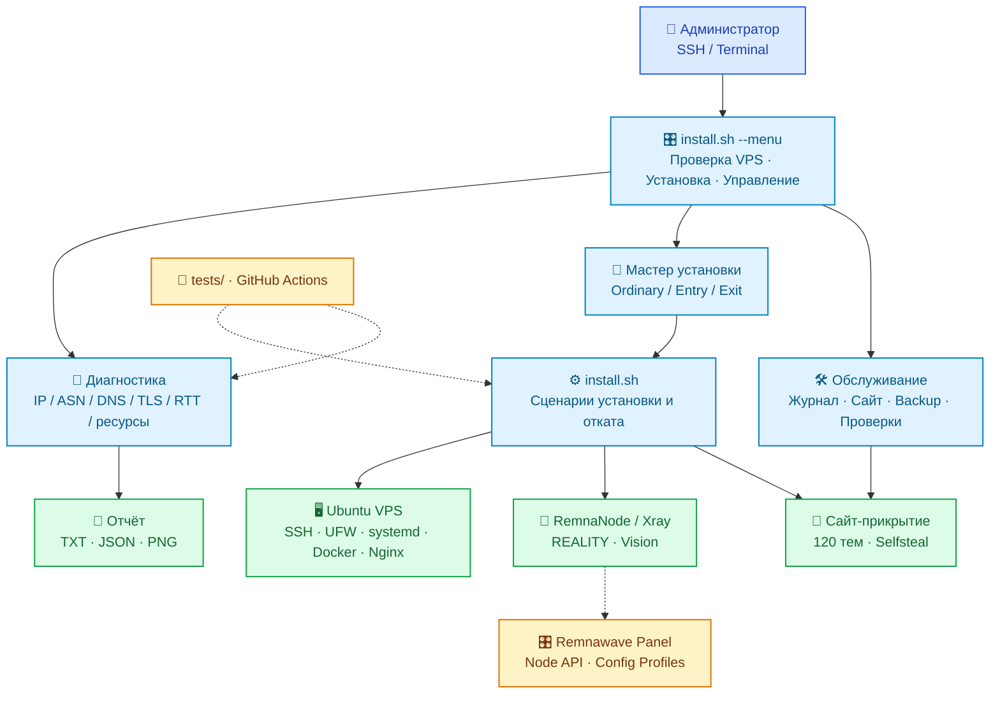
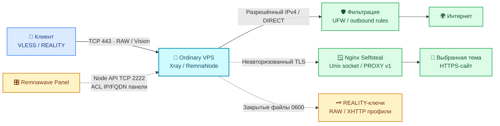
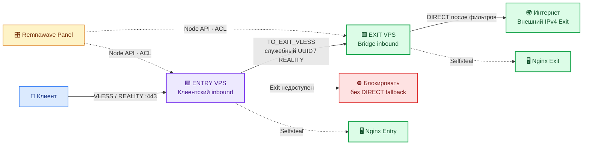

<a id="install"></a>
## 🚀 Установка Node Install — два способа

Обе команды открывают **то же самое терминальное меню**. Никакие системные настройки не меняются, пока вы сами не выберете установку. Выполнять в открытой SSH-сессии под `root` на **новой тестовой VPS**.

### 1. 🐙 С GitHub

Клонирует `main` в **новый уникальный каталог**. Старые папки и рабочие конфигурации не удаляются. Перед запуском проверяет SHA-256 установщика, состав релиза и точный идентификатор сборки.

```bash
bash <<'NODE_INSTALL_GITHUB'
set -Eeuo pipefail
[[ "$(id -u)" == 0 ]] || { echo 'Нужен root'; exit 1; }
command -v git >/dev/null || { echo 'Не установлен git'; exit 1; }
checkout="$(mktemp -d /root/NodeInstall-git-XXXXXXXX)"
git clone --depth 1 https://github.com/SUXARIK-GITHUB/Node_Install.git "$checkout"
cd "$checkout"
printf '%s  %s\n' '144d1d5948e492153d9688b00b5ebf7ee1d9598ea3f7e5b634609e0300212e95' 'install.sh' | sha256sum --check
sha256sum --check --status SHA256SUMS
python3 scripts/verify_release.py --root .
python3 - <<'PY_BUILD'
import json
from pathlib import Path
m = json.loads(Path('BUILD_MANIFEST.json').read_text(encoding='utf-8'))
if (m.get('version'), m.get('build_id'), m.get('release_status')) != (
    '2.5.18', '20261106-r35-automatic-vps-check', 'INCOMPLETE_STAGING_ONLY'
):
    raise SystemExit('STOP: GitHub содержит другую сборку; меню не запускается')
PY_BUILD
bash -n install.sh
bash ./install.sh --menu < /dev/tty
NODE_INSTALL_GITHUB
```

### 2. 📦 Из полного ZIP-архива

Сначала передайте **полный** `Node_Install_2.5.18-docs-menu_20261106-r35-automatic-vps-check.zip` в `/root` тестовой VPS. Архив распаковывается в отдельный каталог, без перезаписи прежней версии.

```bash
bash <<'NODE_INSTALL_ARCHIVE'
set -Eeuo pipefail
[[ "$(id -u)" == 0 ]] || { echo 'Нужен root'; exit 1; }
archive="/root/Node_Install_2.5.18-docs-menu_20261106-r35-automatic-vps-check.zip"
[[ -f "$archive" ]] || { echo "Архив не найден: $archive"; exit 1; }
checkout="$(mktemp -d /root/NodeInstall-zip-XXXXXXXX)"
unzip -q "$archive" -d "$checkout"
cd "$checkout/Node_Install"
sha256sum --check --status SHA256SUMS
python3 scripts/verify_release.py --root .
bash -n install.sh
bash ./install.sh --menu < /dev/tty
NODE_INSTALL_ARCHIVE
```

> ⚠️ **Перед настоящей установкой:** сохраните snapshot VPS, проверьте его восстановление и откройте аварийную консоль хостера. Установщик меняет SSH, UFW, Docker, Nginx, systemd, IPv6/GRUB и сетевые правила. Это **текущая staging-сборка**, не подтверждённая на вашем production-сервере. GitHub-команда намеренно остановится, если в `main` ещё нет r35. Внутренние SHA-256 проверяют целостность, но не заменяют независимую проверку происхождения релиза.

---

<div align="center">

# 🌌 VKARMANI · NODE INSTALL

**Серверная нода под контролем: от проверки VPS до REALITY и каскада**

`2.5.18 · r35` · `Ubuntu / SSH` · `VLESS · REALITY · Vision` · `IPv4`

[🗺 Карта проекта](#project-map) · [🟦 Обычная нода](#ordinary-map) · [🟪 Каскад](#cascade-map) · [🎛 Remnawave](#panel) · [📚 Документация](#documentation)

</div>

Node Install — инструмент для развёртывания и обслуживания серверной части VKARMANI. Он собирает установку, проверку VPS, работу с маскирующим сайтом и диагностику в одно терминальное меню. Его задача — сделать сложные серверные действия понятными и воспроизводимыми, а не скрывать от администратора, что именно меняется на машине.

**Здесь есть две схемы работы:** одна обычная нода либо каскад из двух независимых VPS. Ниже — путь трафика, состав проекта и то, что потребуется настроить в Remnawave. Подробная история изменений находится в [CHANGELOG.md](CHANGELOG.md), а не в начале README.

<a id="navigation"></a>
## 🧭 Где что находится

| Нужно сделать | Открыть |
|:--|:--|
| Запустить на новой VPS | [🐙 GitHub или 📦 ZIP](#install) |
| Понять, из чего состоит проект | [🗺 Карта проекта](#project-map) |
| Настроить одну ноду | [🟦 Ordinary](#ordinary-map) · [RAW](#raw) · [XHTTP](#xhttp) |
| Собрать Entry → Exit | [🟪 Каскад](#cascade-map) · [Профили](#cascade) · [Порядок установки](#cascade-setup) |
| Подключить ноды в панели | [🎛 Remnawave](#panel) |
| Проверить VPS и экспортировать отчёт | [🔎 Диагностика](#diagnostics) |
| Выбрать маскирующий сайт | [🎨 120 сайтов](#sites-tcp-probes) |
| Проверить безопасность и восстановление | [🛡 Границы и откат](#safety) · [🛠 Команды](#operations) |

<a id="project-map"></a>
## 🗺 Карта проекта



<details>
<summary>📁 Структура репозитория — что за что отвечает</summary>

```text
Node_Install/
├── install.sh                  Главный CLI и установщик
├── scripts/
│   ├── terminal_ui.py          Терминальное меню и навигация
│   ├── verify_release.py       Контроль состава, хешей и версии
│   ├── staging_web_deploy.py   Развёртывание и откат сайта
│   ├── site_manager.py         Управление каталогом тем
│   └── ...                     Диагностика, подготовка, аудит
├── integrations/
│   ├── vps_dashboard.py        Сбор данных диагностики
│   ├── vps_report.py           Разделы отчёта и экспорт PNG
│   ├── traffic_limits.py      Лимиты скорости/объёма
│   ├── cascade_*.py           Подготовка и проверки каскада
│   └── ...                     Сетевые и Xray-модули
├── site-catalog/              108 тем статических сайтов
├── cover-variants/            12 исходных отдельных тем
├── preview/                   Локальная галерея и превью
├── examples/                  Образцы полных Xray JSON
├── tests/                     Автономные тесты и сценарии отказа
├── docs/                      Инструкции, исследования, история
├── .github/workflows/         GitHub Actions (матрица ОС)
├── BUILD_MANIFEST.json        Состав и SHA-256 релиза
└── SHA256SUMS                 Контрольные суммы файлов
```

</details>

### Что уже можно делать

- **🔎 Проверять VPS.** Русскоязычный экран с девятью разделами: ресурсы, IP/ASN, геолокация, сайты/API, DNS/TLS, задержки, CDN и сеть. Отчёт можно сохранить в TXT/JSON/PNG.
- **🟦 Разворачивать Ordinary.** RAW + REALITY + Vision — основной сценарий; XHTTP — альтернативный профиль, а не второй слушатель на том же порту.
- **🟪 Готовить каскад.** Отдельные роли Entry и Exit, собственные ключи и закрытый служебный мост; для работы требуются настройки Remnawave.
- **🎨 Выбирать сайт.** В комплекте **120 тематик**: 12 отдельных исходных и 108 в каталоге, включая 12 дополнительно оформленных композиций. Это не 120 полностью независимых движков.
- **🧰 Обслуживать установленную ноду.** Просмотр журнала, диагностика, управляемые изменения сайта, ограниченные сценарии rollback и проверка конфигурации.

<a id="roles"></a>
## 🧩 Два режима работы

| | 🟦 Обычная нода | 🟪 Каскад Entry → Exit |
|:--|:--|:--|
| VPS | **1 сервер** | **2 независимых сервера** |
| Путь | Клиент → Ordinary → Интернет | Клиент → Entry → Exit → Интернет |
| Роль сервера | Принимает и выпускает трафик | Entry принимает; Exit выпускает |
| Профили Panel | Один Ordinary | Два разных: Entry и Exit |
| Публичный Host клиента | На Ordinary | **Только на Entry** |
| При потере следующего узла | Нет второго узла | На Entry **нет DIRECT fallback** |

<a id="architecture"></a>
<a id="ordinary-map"></a>
### 🟦 Карта 1 · Обычная нода



**Как читать карту.** Клиент подключается к публичному домену и TCP/443. Успешно авторизованный VLESS-трафик после правил фильтрации уходит в Интернет с IPv4 ноды. Другой TLS-трафик может попадать в локальную цепочку Nginx Selfsteal, где отображается выбранный сайт. Панель управляет Node API по отдельному порту с ограничением источника — **не открывайте 2222 всему Интернету**.

Для Ordinary нужен один Node, один активный профиль и Host в Remnawave. RAW и XHTTP выбираются **альтернативно**, не одновременно на TCP/443. Полные образцы ниже: [RAW + REALITY + Vision](#raw) и [XHTTP + REALITY](#xhttp).

<a id="cascade-map"></a>
### 🟪 Карта 2 · Каскад Entry → Exit



**Суть каскада:** клиент знает адрес **Entry**; Entry принимает соединение и передаёт разрешённый трафик в **Exit** по отдельному служебному соединению. Внешний IPv4 для сайтов — адрес **Exit**. Если Exit недоступен, Entry не должен переключаться на прямой Интернет. Это обязательное свойство конфигурации, которое нужно проверить живым тестом, а не только наличием правил в JSON.

На каждой VPS своя пара REALITY-ключей, свой профиль, свой сайт и свой Node в Panel. Клиентский Host публикуется **только на Entry**. Bridge-user (service-user) назначается отдельным пользователем и Internal Squad **только Exit**. Правильный порядок развёртывания: **сначала Exit, затем Entry**, на разных чистых VPS. [Практический runbook](docs/CASCADE_R5_ROLE_INSTALL_AND_PANEL.md).

<a id="requirements"></a>
## ✅ Что подготовить до установки

| Что | Зачем |
|:--|:--|
| **Новая VPS с Ubuntu** и root-доступом | Установщик меняет общесистемные службы и доступ |
| **Публичный IPv4 и домен с DNS A** | Клиентское подключение и сертификат |
| **IP или домен Remnawave Panel** | Настройка ACL для Node API TCP/2222 |
| **SECRET_KEY ноды** | Подключение Ordinary к панели; не публикуйте его |
| **Snapshot и аварийная консоль** | Восстановление SSH/сети при неудачной установке |
| **Для каскада — два отдельных role-bundle.json** | Не смешивать ключи Entry/Exit; права `0600` |

**Парольный SSH:** текущая политика проекта использует парольный вход вместо SSH-ключей. Это осознанная конфигурация, требующая сильного пароля, защиты от перебора и доступа к консоли провайдера. Не делайте неподготовленную смену SSH/UFW на рабочем сервере.

<a id="diagnostics"></a>
## 🔎 Проверка VPS перед установкой

Выбери первый пункт и дождись отчёта — никаких IP, адресов или настроек вводить не придётся. Первый пункт меню — не просто «доступен / недоступен». Он помогает понять, какой сервер вы получили: ресурсы, IP и ASN, разные ответы GeoIP, DNS, доступность HTTPS-сервисов, задержки, потери, маршрут и CDN. Результаты разделены по девяти экранам и снабжены русскими пояснениями.

**Управление:** колесо мыши (если SSH-клиент передаёт события), стрелки и `PgUp/PgDn`; `0` — сводка, `1–9` — разделы, `E` — сохранение **TXT / JSON / PNG** в приватную папку. **Ничего вводить не нужно:** при выборе «Проверка VPS» автоматически запускаются все разделы, включая щадящий тест CPU/RAM (0,25 секунды CPU), временную запись диска (8 MiB) и небольшую HTTPS-проверку входящей/исходящей скорости до Cloudflare (не более 2 MiB на направление). Случаи ошибки показываются как «не измерено», а не заменяются выдуманными цифрами. Цветные статусы помогают быстро читать отчёт, но не подменяют измерения: `403` не всегда означает блокировку, а GeoIP не доказывает «чистоту» адреса.

Подробности: [автоматическая проверка](docs/RELEASE_2.5.18_R35_AUTOMATIC_VPS.md) · [диагностика VPS](docs/RELEASE_2.5.18_R32_VPS_DASHBOARD.md) · [о качестве сети](docs/EXTERNAL_PATH_DIAGNOSTICS_2.5.0.md).

<a id="panel"></a>
## 🎛 Remnawave — что создать в панели

Установщик на VPS **не создаёт автоматически** Nodes, Hosts и Internal Squads в панели. Их назначает администратор. В `Config Profiles` используется готовый JSON своей роли, затем профиль связывается с Node, включается inbound и задаются права пользователей.

| Объект | 🟦 Ordinary | 🟪 Entry / Exit |
|:--|:--|:--|
| **Nodes** | Один Ordinary | Два разных: Entry и Exit |
| **Config Profile** | [RAW](#raw) **или** [XHTTP](#xhttp) | [Entry](#cascade-entry-json) **и** [Exit](#cascade-exit-json) |
| **Активный inbound** | Уникальный `VK_RAW_*` | `VK_CASCADE_ENTRY_*` и `VK_CASCADE_EXIT_*` |
| **Host в подписке** | На Ordinary TCP/443 | **Только Entry** TCP/443 |
| **Internal Squad** | Клиенты Ordinary | Клиенты → Entry; service-user → **только Exit** |
| **Bridge VLESS UUID** | Не требуется | На Entry — **VLESS UUID service-user на Exit** |

**После успешной Ordinary-установки:** приватный полный профиль RAW находится в `/root/vkarmani-raw-profile.json`; альтернативный XHTTP-шаблон — в `/root/vkarmani-xhttp-profile.json` (когда он подготовлен). Их нельзя публиковать: внутри есть чувствительные параметры. Для панели используют только профиль, подходящий фактическому inbound.

Не переносите `REPLACE_WITH_*` из примеров в работающую панель: образцы показывают структуру, а реальные ключи и идентификаторы должны быть сгенерированы на своих нодах. Убедитесь, что `inbound.tag` не повторяет другие активные inbound.

[Официальная документация Config Profiles](https://docs.rw/learn-en/config-profiles/) · [Hosts](https://docs.rw/learn-en/hosts/) · [Internal Squads](https://docs.rw/learn-en/squads/).

<a id="selfsteal"></a>
<a id="firewall"></a>
<a id="safety"></a>
## 🛡 Сеть, Selfsteal и безопасность

- **Публичный HTTP/80** нужен для ACME/редиректа; HTTPS/TLS проверяйте также снаружи VPS.
- **Node API TCP/2222** должен быть доступен только разрешённым IP панели (или IPv4, полученным из её домена). Не открывайте управляющий порт всему Интернету.
- **IPv6** выключается в соответствии с текущей политикой проекта; после перезагрузки проверяйте реальную маршрутизацию, а не только настройки файлов.
- **Selfsteal и REALITY** помогают организовать TLS-цепочку с локальным сайтом. Они не являются гарантией отсутствия блокировок, обнаружения или сетевых ограничений. Cover/REALITY **не гарантируют** доступность из любой сети.
- **Незавершённая установка** — повод проверить журнал и checkpoint, а не запускать установку поверх повреждённых конфигов. Полное восстановление системы выполняется из проверенного snapshot, а не из кнопки «удалить».

<a id="inbounds"></a>
## 📋 Полные образцы профилей Xray для Remnawave

Код ниже оставлен без сокращений: каждый полный JSON можно сверить с файлами в `examples/`. Он помещён под раскрывающиеся заголовки, чтобы README можно было читать без погружения в Xray-синтаксис.


Все примеры **полные Xray JSON**. Они содержат `REPLACE_WITH_*`, зарезервированные IP и демонстрационные FQDN — не реальные ключи. Для практического развертывания используйте **сгенерированный профиль своей VPS**, а примеры — для проверки структуры и правил.

<a id="raw"></a>
### ⚡ Ordinary · RAW + REALITY + Vision

RAW — основной профиль, `flow: xtls-rprx-vision`; один listener `0.0.0.0:443`. Пример совпадает с [`examples/inbound-raw-full.example.json`](examples/inbound-raw-full.example.json).

<details>
<summary><b>Показать полный RAW inbound + outbound + routing</b></summary>

<!-- BEGIN RAW FULL EXAMPLE -->

```json
{
  "log": {
    "loglevel": "warning"
  },
  "dns": {
    "servers": [
      "1.1.1.1",
      "1.0.0.1",
      "8.8.8.8"
    ],
    "queryStrategy": "UseIPv4",
    "disableCache": false,
    "serveStale": true,
    "serveExpiredTTL": 3600,
    "enableParallelQuery": true
  },
  "inbounds": [
    {
      "tag": "VK_RAW_REALITY_REPLACE_WITH_NODE_TAG",
      "listen": "0.0.0.0",
      "port": 443,
      "protocol": "vless",
      "settings": {
        "clients": [],
        "decryption": "none",
        "flow": "xtls-rprx-vision"
      },
      "sniffing": {
        "enabled": true,
        "routeOnly": true,
        "destOverride": [
          "http",
          "tls",
          "quic"
        ]
      },
      "streamSettings": {
        "network": "raw",
        "security": "reality",
        "realitySettings": {
          "show": false,
          "target": "/dev/shm/nginx.sock",
          "xver": 1,
          "minClientVer": "0.0.0",
          "spiderX": "/",
          "serverNames": [
            "node.example.com"
          ],
          "privateKey": "REPLACE_WITH_PRIVATE_KEY_FROM_NODE",
          "shortIds": [
            "REPLACE_WITH_SHORT_ID_FROM_NODE"
          ]
        }
      }
    }
  ],
  "outbounds": [
    {
      "tag": "DIRECT",
      "protocol": "freedom",
      "settings": {
        "domainStrategy": "UseIPv4",
        "finalRules": [
          {
            "ip": [
              "geoip:private",
              "::/0"
            ],
            "action": "block"
          }
        ]
      }
    },
    {
      "tag": "BLOCK",
      "protocol": "blackhole"
    }
  ],
  "routing": {
    "domainStrategy": "IPOnDemand",
    "rules": [
      {
        "type": "field",
        "protocol": [
          "bittorrent"
        ],
        "outboundTag": "BLOCK"
      },
      {
        "type": "field",
        "domain": [
          "geosite:private"
        ],
        "outboundTag": "BLOCK"
      },
      {
        "type": "field",
        "ip": [
          "geoip:private",
          "0.0.0.0/8",
          "10.0.0.0/8",
          "100.64.0.0/10",
          "127.0.0.0/8",
          "169.254.0.0/16",
          "172.16.0.0/12",
          "192.168.0.0/16",
          "224.0.0.0/4",
          "240.0.0.0/4",
          "203.0.113.10/32",
          "::/0",
          "198.51.100.20/32"
        ],
        "outboundTag": "BLOCK"
      }
    ]
  }
}
```

<!-- END RAW FULL EXAMPLE -->

</details>

<a id="xhttp"></a>
### 🌐 Ordinary · XHTTP + REALITY

Альтернатива RAW, **не второй одновременный listener на 443**. `flow` пустой, `xhttpSettings.path` генерируется самой нодой. Переключение профиля — в Panel; `--prepare-xhttp` только готовит JSON. [Runbook XHTTP](docs/TRANSPORT_SWITCHING_2.5.4.md).

<details>
<summary><b>Показать полный XHTTP inbound + outbound + routing</b></summary>

<!-- BEGIN XHTTP FULL EXAMPLE -->

```json
{
  "log": {
    "loglevel": "warning"
  },
  "dns": {
    "servers": [
      "1.1.1.1",
      "1.0.0.1",
      "8.8.8.8"
    ],
    "queryStrategy": "UseIPv4",
    "disableCache": false,
    "serveStale": true,
    "serveExpiredTTL": 3600,
    "enableParallelQuery": true
  },
  "inbounds": [
    {
      "tag": "VK_RAW_REALITY_REPLACE_WITH_NODE_TAG",
      "listen": "0.0.0.0",
      "port": 443,
      "protocol": "vless",
      "settings": {
        "clients": [],
        "decryption": "none",
        "flow": ""
      },
      "sniffing": {
        "enabled": true,
        "routeOnly": true,
        "destOverride": [
          "http",
          "tls",
          "quic"
        ]
      },
      "streamSettings": {
        "network": "xhttp",
        "security": "reality",
        "realitySettings": {
          "show": false,
          "target": "/dev/shm/nginx.sock",
          "xver": 1,
          "minClientVer": "0.0.0",
          "spiderX": "/",
          "serverNames": [
            "node.example.com"
          ],
          "privateKey": "REPLACE_WITH_PRIVATE_KEY_FROM_NODE",
          "shortIds": [
            "REPLACE_WITH_SHORT_ID_FROM_NODE"
          ]
        },
        "xhttpSettings": {
          "host": "node.example.com",
          "path": "/REPLACE_WITH_NODE_GENERATED_XHTTP_PATH",
          "mode": "auto"
        }
      }
    }
  ],
  "outbounds": [
    {
      "tag": "DIRECT",
      "protocol": "freedom",
      "settings": {
        "domainStrategy": "UseIPv4",
        "finalRules": [
          {
            "ip": [
              "geoip:private",
              "::/0"
            ],
            "action": "block"
          }
        ]
      }
    },
    {
      "tag": "BLOCK",
      "protocol": "blackhole"
    }
  ],
  "routing": {
    "domainStrategy": "IPOnDemand",
    "rules": [
      {
        "type": "field",
        "protocol": [
          "bittorrent"
        ],
        "outboundTag": "BLOCK"
      },
      {
        "type": "field",
        "domain": [
          "geosite:private"
        ],
        "outboundTag": "BLOCK"
      },
      {
        "type": "field",
        "ip": [
          "geoip:private",
          "0.0.0.0/8",
          "10.0.0.0/8",
          "100.64.0.0/10",
          "127.0.0.0/8",
          "169.254.0.0/16",
          "172.16.0.0/12",
          "192.168.0.0/16",
          "224.0.0.0/4",
          "240.0.0.0/4",
          "203.0.113.10/32",
          "::/0",
          "198.51.100.20/32"
        ],
        "outboundTag": "BLOCK"
      }
    ]
  }
}
```

<!-- END XHTTP FULL EXAMPLE -->

</details>

<a id="cascade"></a>
## ⛓️ Каскад · два независимых inbound

| Параметр | 🧭 Entry (вход) | 🌍 Exit (выход) |
|---|---|---|
| Клиенты `clients` | Управляет Panel, только тестовые клиенты | **Только мостовой service-user** через отдельный Squad |
| Transport | `raw` + `reality`, Vision | `raw` + `reality`, Vision |
| `target` и `xver` | Локальный Nginx `/dev/shm/nginx.sock`, `1` | Свой локальный Nginx `/dev/shm/nginx.sock`, `1` |
| Основной outbound | `TO_EXIT_VLESS` | `DIRECT` **после проверки bridge-user** |
| Безопасный fallback | `BLOCK` — **первый outbound** | `BLOCK` и `finalRules` для приватных IP |
| DNS | `domainStrategy: AsIs`, **без встроенного DNS** | IPv4 DNS на Exit; локальная обработка только там |
| REALITY | **Своя** пара ключей и короткий ID | **Другая** пара ключей и короткий ID |

Полные JSON ниже **синхронизированы с `integrations/cascade_profiles.py`**. Они включают inbound, outbound, правила private-IP/IPv6 block и обработку клиентских соединений. При замене всех плейсхолдеров важны совпадение UUID, публичного ключа и `shortId` Exit с мостовым outbound Entry. Разные inbound tags обязательны: дубликат `tag` Remnawave отклонит.

<a id="cascade-entry-json"></a>
### 🧭 1. Entry — клиентский inbound и мост в Exit

[Справочный JSON Entry](examples/cascade-entry-profile.reference.json) · [Ролевой генератор](integrations/cascade_profiles.py)

- **Вход:** VLESS RAW/REALITY/Vision, `0.0.0.0:443`; `clients` назначаются Panel.
- **Маршрут:** block для BitTorrent и private/IPv6, затем весь разрешённый клиентский трафик в `TO_EXIT_VLESS`. **Никакого DIRECT, DNS-resolver или balancer на Entry.**
- **Мост:** Exit IPv4:443, `service_user_uuid` именно пользователя Exit, `serverName`/`publicKey`/`shortId` **выходной** ноды.

<details>
<summary><b>Показать полный JSON Entry · inbound + TO_EXIT_VLESS + routing</b></summary>

<!-- BEGIN CASCADE ENTRY FULL EXAMPLE -->
```json
{
  "log": {
    "loglevel": "warning"
  },
  "inbounds": [
    {
      "tag": "VK_CASCADE_ENTRY_REALITY_REPLACE_WITH_REAL_TAG",
      "port": 443,
      "listen": "0.0.0.0",
      "protocol": "vless",
      "settings": {
        "clients": [],
        "decryption": "none",
        "flow": "xtls-rprx-vision"
      },
      "sniffing": {
        "enabled": true,
        "routeOnly": true,
        "destOverride": [
          "http",
          "tls",
          "quic"
        ]
      },
      "streamSettings": {
        "network": "raw",
        "security": "reality",
        "realitySettings": {
          "show": false,
          "target": "/dev/shm/nginx.sock",
          "xver": 1,
          "minClientVer": "0.0.0",
          "spiderX": "/",
          "serverNames": [
            "entry.example.com"
          ],
          "privateKey": "REPLACE_WITH_ENTRY_PRIVATE_KEY",
          "shortIds": [
            "REPLACE_WITH_ENTRY_SHORT_ID"
          ]
        }
      }
    }
  ],
  "outbounds": [
    {
      "tag": "BLOCK",
      "protocol": "blackhole"
    },
    {
      "tag": "TO_EXIT_VLESS",
      "protocol": "vless",
      "settings": {
        "vnext": [
          {
            "address": "198.51.100.20",
            "port": 443,
            "users": [
              {
                "id": "REPLACE_WITH_EXIT_SERVICE_USER_UUID",
                "encryption": "none",
                "flow": "xtls-rprx-vision"
              }
            ]
          }
        ]
      },
      "streamSettings": {
        "network": "raw",
        "security": "reality",
        "realitySettings": {
          "serverName": "exit.example.com",
          "fingerprint": "chrome",
          "publicKey": "REPLACE_WITH_EXIT_PUBLIC_KEY",
          "shortId": "REPLACE_WITH_EXIT_SHORT_ID",
          "spiderX": "/"
        }
      }
    }
  ],
  "routing": {
    "domainStrategy": "AsIs",
    "rules": [
      {
        "type": "field",
        "protocol": [
          "bittorrent"
        ],
        "outboundTag": "BLOCK"
      },
      {
        "type": "field",
        "domain": [
          "geosite:private"
        ],
        "outboundTag": "BLOCK"
      },
      {
        "type": "field",
        "ip": [
          "0.0.0.0/8",
          "10.0.0.0/8",
          "100.64.0.0/10",
          "127.0.0.0/8",
          "169.254.0.0/16",
          "172.16.0.0/12",
          "192.0.0.0/24",
          "192.0.2.0/24",
          "192.168.0.0/16",
          "198.18.0.0/15",
          "198.51.100.0/24",
          "203.0.113.0/24",
          "224.0.0.0/4",
          "240.0.0.0/4",
          "::/0",
          "203.0.113.10/32",
          "198.51.100.20/32"
        ],
        "outboundTag": "BLOCK"
      },
      {
        "type": "field",
        "inboundTag": [
          "VK_CASCADE_ENTRY_REALITY_REPLACE_WITH_REAL_TAG"
        ],
        "outboundTag": "TO_EXIT_VLESS"
      }
    ]
  }
}
```
<!-- END CASCADE ENTRY FULL EXAMPLE -->

</details>

<a id="cascade-exit-json"></a>
### 🌍 2. Exit — bridge inbound и фильтр выхода

[Справочный JSON Exit](examples/cascade-exit-profile.reference.json) · [Сценарий установки](docs/CASCADE_R5_ROLE_INSTALL_AND_PANEL.md)

- **Вход:** отдельный VLESS/REALITY на 443. Только назначенный **Panel service-user** из закрытого Exit Internal Squad.
- **Выход:** `DIRECT` через IPv4 после фильтров `routing` и `freedom.finalRules`, с запретом частных/служебных/IPv6 сетей; BitTorrent блокируется.
- **Fallback:** собственный Nginx и независимые REALITY ключи; **никаких** исходящих `TO_EXIT_VLESS` на Exit.

<details>
<summary><b>Показать полный JSON Exit · inbound + DIRECT + routing</b></summary>

<!-- BEGIN CASCADE EXIT FULL EXAMPLE -->
```json
{
  "log": {
    "loglevel": "warning"
  },
  "dns": {
    "servers": [
      "1.1.1.1",
      "1.0.0.1",
      "8.8.8.8"
    ],
    "queryStrategy": "UseIPv4"
  },
  "inbounds": [
    {
      "tag": "VK_CASCADE_EXIT_REALITY_REPLACE_WITH_REAL_TAG",
      "port": 443,
      "listen": "0.0.0.0",
      "protocol": "vless",
      "settings": {
        "clients": [],
        "decryption": "none",
        "flow": "xtls-rprx-vision"
      },
      "sniffing": {
        "enabled": true,
        "routeOnly": true,
        "destOverride": [
          "http",
          "tls",
          "quic"
        ]
      },
      "streamSettings": {
        "network": "raw",
        "security": "reality",
        "realitySettings": {
          "show": false,
          "target": "/dev/shm/nginx.sock",
          "xver": 1,
          "minClientVer": "0.0.0",
          "spiderX": "/",
          "serverNames": [
            "exit.example.com"
          ],
          "privateKey": "REPLACE_WITH_EXIT_PRIVATE_KEY",
          "shortIds": [
            "REPLACE_WITH_EXIT_SHORT_ID"
          ]
        }
      }
    }
  ],
  "outbounds": [
    {
      "tag": "DIRECT",
      "protocol": "freedom",
      "settings": {
        "domainStrategy": "UseIPv4",
        "finalRules": [
          {
            "ip": [
              "0.0.0.0/8",
              "10.0.0.0/8",
              "100.64.0.0/10",
              "127.0.0.0/8",
              "169.254.0.0/16",
              "172.16.0.0/12",
              "192.0.0.0/24",
              "192.0.2.0/24",
              "192.168.0.0/16",
              "198.18.0.0/15",
              "198.51.100.0/24",
              "203.0.113.0/24",
              "224.0.0.0/4",
              "240.0.0.0/4",
              "::/0",
              "203.0.113.10/32",
              "198.51.100.20/32"
            ],
            "action": "block"
          }
        ]
      },
      "streamSettings": {
        "sockopt": {
          "domainStrategy": "ForceIPv4"
        }
      }
    },
    {
      "tag": "BLOCK",
      "protocol": "blackhole"
    }
  ],
  "routing": {
    "domainStrategy": "IPOnDemand",
    "rules": [
      {
        "type": "field",
        "protocol": [
          "bittorrent"
        ],
        "outboundTag": "BLOCK"
      },
      {
        "type": "field",
        "domain": [
          "geosite:private"
        ],
        "outboundTag": "BLOCK"
      },
      {
        "type": "field",
        "ip": [
          "0.0.0.0/8",
          "10.0.0.0/8",
          "100.64.0.0/10",
          "127.0.0.0/8",
          "169.254.0.0/16",
          "172.16.0.0/12",
          "192.0.0.0/24",
          "192.0.2.0/24",
          "192.168.0.0/16",
          "198.18.0.0/15",
          "198.51.100.0/24",
          "203.0.113.0/24",
          "224.0.0.0/4",
          "240.0.0.0/4",
          "::/0",
          "203.0.113.10/32",
          "198.51.100.20/32"
        ],
        "outboundTag": "BLOCK"
      },
      {
        "type": "field",
        "inboundTag": [
          "VK_CASCADE_EXIT_REALITY_REPLACE_WITH_REAL_TAG"
        ],
        "outboundTag": "DIRECT"
      }
    ]
  }
}
```
<!-- END CASCADE EXIT FULL EXAMPLE -->

</details>

> [!CAUTION]
> Это **образцы для разбора**, не готовые для импорта: у них несуществующие приватные ключи, UUID и документационные IP. Не заменяйте автоматически весь профиль реальной панели. Для использования сначала генерируется **закрытая пара**, после чего каждая VPS получает только собственный приватный ключ. Проверка конфигурации — обязательна перед первым клиентским подключением.

<a id="cascade-setup"></a>
### 🔧 Подготовка и установка каскада на двух чистых staging VPS

На **защищённой машине оператора** с установленной зависимостью `cryptography` создайте пару, указав свои **реальные** IPv4/FQDN (не `203.0.113.0/24`, не `198.51.100.0/24`). Каталог `/root` и создаваемые bundles должны оставаться root-only:

```bash
umask 077
sudo python3 integrations/cascade_deployment.py create-pair \
  --entry-domain "$ENTRY_DOMAIN" --entry-ipv4 "$ENTRY_IPV4" \
  --exit-domain "$EXIT_DOMAIN" --exit-ipv4 "$EXIT_IPV4" \
  --output /root/cascade-private-pair.json
sudo python3 integrations/cascade_deployment.py prepare \
  --pair /root/cascade-private-pair.json \
  --output /root/cascade-private-split
```

**Разделить секреты:** на Exit передать **только** `exit/role-bundle.json`; на Entry — **только** `entry/role-bundle.json`. Не помещать закрытые JSON в Git, чат или открытые журналы.

```bash
# Сначала Exit, затем Entry; команды на РАЗНЫХ VPS.
# EXIT VPS:
sudo bash ./install.sh --cascade-role exit \
  --cascade-bundle /root/cascade/exit/role-bundle.json --no-reboot

# ENTRY VPS:
sudo bash ./install.sh --cascade-role entry \
  --cascade-bundle /root/cascade/entry/role-bundle.json --no-reboot
```

Далее назначить объекты тестовой Panel согласно [пошаговому runbook](docs/CASCADE_R5_ROLE_INSTALL_AND_PANEL.md), проверить фактический JSON командой аудитора и только затем — реальных клиентов. Автоматического создания Panel Nodes/Hosts/Squads здесь **нет**.

<a id="sites-tcp-probes"></a>
## 🎨 Сайты и маскирующие страницы

В комплекте **120 тем**: 12 оригинальных вариантов в `cover-variants/` и 108 в `site-catalog/` (из них 12 — дополнительные авторские HTML-композиции). У каждой темы есть основные ресурсы и страница HTTP 404; это не 120 разных веб-движков. Локальную галерею можно открыть в браузере: `preview/site-gallery/index.html`.

**Изменить тему на уже установленной тестовой ноде** можно после snapshot, строго с проверкой домена и Nginx:

```bash
sudo python3 scripts/staging_web_deploy.py site-change --theme 110-blue-harbor --expected-domain node.example.com --confirm-staging
sudo python3 scripts/staging_web_deploy.py status
sudo python3 scripts/staging_web_deploy.py site-rollback --confirm-staging
```

Новая тема при обычной установке публикуется лишь после успешной финализации основной ноды. Ошибка публикации сайта может дать код `20` при уже установленном ядре — это **не полный успех**: проверяйте журнал и откат сайта. Подробности: [каталог и безопасность](docs/RELEASE_2.5.18_R21_CATALOG_AND_SAFETY.md) · [управление сайтом](docs/RELEASE_2.5.18_R24_PHASE1_SITES_SELFSTEAL_NETWORK.md).

<a id="rkn"></a>
## 🛡 RKN / UFW / доступ панели

Отдельные RKN-списки не заменяют основной ACL Node API. При смене IP панели проверяйте реальные разрешённые источники; не используйте слепой сброс UFW на работающей машине.

```bash
sudo bash ./install.sh --rkn-status
sudo bash ./install.sh --rkn-update
sudo bash ./install.sh --rkn-sync-panel
```

[Политика RKN](docs/RKN_FAILSAFE_2.5.9.md) · [Security](SECURITY.md).

<a id="operations"></a>
## 🛠 Обслуживание и диагностика

| Команда | Для чего |
|:--|:--|
| `bash ./install.sh --menu` | Открыть главное меню; выход возвращает SSH-оболочку |
| `sudo bash ./install.sh --check` | Локальная проверка ноды, не замена тесту клиента |
| `bash ./install.sh --diagnose-network` | Счётчики и сетевое состояние |
| `bash ./install.sh --diagnose-selfsteal` | Диагностика Nginx / Selfsteal |
| `bash ./install.sh --diagnose-resources --seconds 15` | Краткая динамика ресурсов |
| `bash ./install.sh --vps-check --format table full` | Проверка VPS в текстовом виде |
| `bash ./install.sh --help` | Все доступные опции CLI |

При установке из терминального меню живой журнал пишется в закрытый файл `/root/node-install-*.log` (права `0600`). Доступ к приватным REALITY-ключам также ограничен: отображение `PrivateKey` требует отдельного действия, копирование через OSC 52 зависит от клиента SSH. Нельзя выкладывать такие файлы в Issues, логи CI или общедоступные чаты.

Если установку пришлось прервать, **сначала прочитайте журнал**. Не удаляйте `/var/lib/vkarmani-node`, checkpoint, Docker volumes и резервные копии ради «чистого повтора». Для восстановления системных настроек используйте проверенный snapshot и [документацию оператора](docs/OPERATIONS.md).

<a id="verification"></a>
## 🧪 Проверки перед реальным использованием

```bash
# Из каталога чисто распакованного исходного релиза
sha256sum --check SHA256SUMS
python3 scripts/verify_release.py --root .
bash -n install.sh
bash tests/run.sh
```

Релизный манифест и контрольные суммы проверяют содержимое исходного пакета. GitHub Actions проверяет код на нескольких Linux-окружениях. Эти тесты **не заменяют** установку на отдельной VPS с последующей перезагрузкой и проверкой SSH, DNS/TLS, Docker, Nginx, панели и реального клиента.

Для каскада обязательна отдельная проверка фактического выхода через Exit, DNS/UDP и поведения при его отключении. **XHTTP, Hysteria2, AmneziaWG2 и FinalMask нельзя считать автоматически установленными или проверенными на живой сети только по наличию JSON/шаблонов**. Подробнее: [готовность транспортов](docs/RELEASE_2.5.18_R25_TRANSACTION_AND_TRANSPORT_READINESS.md) и [проверки каскада](docs/R7_SITES_TCP_AND_LIVE_PROBES.md).

<a id="documentation"></a>
## 📚 Документация и история

| Раздел | Ссылка |
|:--|:--|
| Все изменения проекта, включая r22–r35 | [CHANGELOG.md](CHANGELOG.md) |
| Системная безопасность | [SECURITY.md](SECURITY.md) |
| Повседневная эксплуатация | [docs/OPERATIONS.md](docs/OPERATIONS.md) |
| Схема и логика каскада | [Каскад r5](docs/CASCADE_R5_ROLE_INSTALL_AND_PANEL.md) · [r6](docs/R6_CASCADE_OPERATIONS_AND_GATES.md) |
| Состояние REALITY / Nginx / Selfsteal | [Общий обзор](docs/SELFSTEAL_2.2.0.md) |
| Версии Xray | [Xray Core](docs/XRAY_CORE_UPDATES_2.5.5.md) |
| Архивная документация 2.5.15 | [Исторический README](docs/history/README_2.5.4.md) |
| Ранние архитектурные решения 2.5.13 и защита сети 2.5.9 | [Темы r12](docs/RELEASE_2.5.13_R12_SITES.md) · [RKN](docs/RKN_FAILSAFE_2.5.9.md) |

---

<div align="center">

**VKARMANI · Node Install 2.5.18**

[⬆️ Две команды установки](#install) · [🗺 Проект](#project-map) · [🟦 Ordinary](#ordinary-map) · [🟪 Каскад](#cascade-map) · [🔐 Security](SECURITY.md)

</div>
