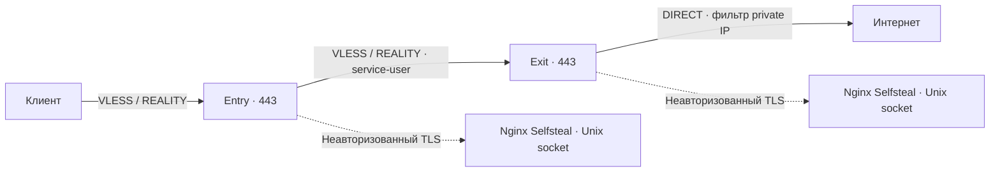

<a id="install"></a>
## ⚡ УСТАНОВКА VKARMANI NODE INSTALL 2.5.10

**Remnawave Node · IPv4-only · VLESS + REALITY · Nginx Selfsteal · обычная нода / Entry / Exit**

> [!WARNING]
> **2.5.10 r7e — локальный непубликованный staging-кандидат, не production-release.** В GitHub опубликована **2.5.10 r7d** (исходный код той же версии установщика), а эти README и справочные JSON обновлены в локальном **r7e**. **Не выполняйте обе команды установки на одном сервере.** Установка меняет SSH, UFW, Docker, Nginx, systemd и GRUB; нужны **новая VPS**, проверенный snapshot и консоль провайдера.

<a id="github-install"></a>
## 📦 GitHub · опубликованная версия 2.5.10 r7d

**Первая команда — с GitHub.** Закреплены опубликованный коммит `817b9c0` и SHA-256 установщика. GitHub r7d уже содержит каскад, шесть сайтов и сетевые тесты; **r7e меняет только README и справочные JSON**. Запускать только на новой VPS после snapshot и проверки консоли провайдера.

```bash
git clone https://github.com/SUXARIK-GITHUB/Node_Install.git Node_Install-github-2.5.10-r7d
cd Node_Install-github-2.5.10-r7d
git checkout --detach 817b9c0e10914b09162c6aa8aacd6cebec328d3f
printf '%s  %s\n' 'f00c1433b83421de3d21b61d3e85e99e96b537c6ed16c0fed7a77b588d846378' 'install.sh' | sha256sum --check
bash -n install.sh
bash install.sh --version
sudo bash ./install.sh --no-reboot
```

<a id="archive-install"></a>
### 📁 Локальная версия 2.5.10 r7e — из полного ZIP

Нужен **именно этот** локальный архив, если требуются Entry/Exit, шесть сайтов и проверка каскада. Перенесите ZIP на **новую тестовую VPS** из доверенного источника; сначала проверьте независимый SHA-256 ZIP, затем выполните:

```bash
unzip Node_Install_2.5.10-docs-menu_20261015-r7e-readme.zip
cd Node_Install
python3 scripts/verify_release.py --root .
sha256sum --check SHA256SUMS
bash -n install.sh
sudo bash ./install.sh --no-reboot
```

**Статус:** 2.5.10 — локальный непубликованный staging (r7e).

**Для каскада:** сначала подготовьте индивидуальные секретные role-bundles, затем устанавливайте роли **на двух отдельных чистых staging VPS** — по одной роли на сервер. Команды приведены в [разделе каскада](#cascade-setup). Не запускайте обычную и каскадную установку поверх существующих нод.

---

<div align="center">

# 🚀 VKARMANI · NODE INSTALL

**Обычная нода · Entry → Exit · проверяемые конфигурации и откат**

`2.5.10 r7e (документация)` · `staging only` · `IPv4-only` · `RAW / Vision`

[Начало](#install) · [Режимы](#roles) · [Профили](#inbounds) · [Каскад](#cascade) · [Сайты / TCP](#sites-tcp-probes) · [Команды](#operations) · [Проверки](#verification)

</div>

---

<a id="navigation"></a>
## 🧭 Быстрая навигация

| Нужно | Открыть |
|---|---|
| Установить обычную ноду / выбрать роль | [Режимы](#roles) · [Требования](#requirements) |
| Взять правильный VLESS + REALITY inbound | [RAW](#raw) · [XHTTP](#xhttp) · [Entry и Exit](#cascade) |
| Настроить объекты в Remnawave | [Схема и назначение](#panel) · [Ролевой runbook](docs/CASCADE_R5_ROLE_INSTALL_AND_PANEL.md) |
| Сменить сайт или настроить TCP stream | [Шесть тем / Nginx TCP](#sites-tcp-probes) |
| Проверить клиентов, DNS, UDP и отказ Exit | [Приёмка](#verification) · [Live-процедура](docs/R7_SITES_TCP_AND_LIVE_PROBES.md) |
| Обслужить/восстановить ноду | [CLI](#operations) · [Security](SECURITY.md) · [Operations](docs/OPERATIONS.md) |

<a id="roles"></a>
## 🔀 Режимы установки

| Режим | Назначение | Статус |
|---|---|---|
| **1 · Ordinary** | Одна публичная нода, RAW+REALITY+Vision, прямой выход, Nginx Selfsteal | Код реализован, live r7e не подтверждён |
| **2 · Entry** | Принимает клиентов, пересылает трафик в Exit, **без DIRECT** | Код и offline-проверки, live не подтверждён |
| **2 · Exit** | Принимает служебный мост Entry и выпускает трафик в Интернет | Код и offline-проверки, live не подтверждён |

**Обычная:** установщик спросит скрытый `SECRET_KEY`, домен и IPv4 backend панели. **Каскад:** заранее требуется свой `role-bundle.json` с правами `0600`, роль `entry` или `exit` фиксируется до изменения ОС. Повторная смена роли запрещена. В каскаде используется **только RAW + Vision**; XHTTP здесь не включён.

<a id="requirements"></a>
### Перед установкой

- Выделенная **чистая** VPS, глобальный IPv4, корректный DNS A, совместимый Ubuntu/Debian, доступная консоль провайдера.
- Snapshot **с проверкой восстановления** и сохранённый доступ по SSH. Не устанавливать на техничке, панели или действующих нодах.
- Remnawave Panel и клиентские профили настраиваются отдельно. `clients: []` в JSON — **нормально для шаблона**, пользователей назначает панель.

<a id="architecture"></a>
## 🗺️ Схема подключения



Ordinary работает без Entry/Exit: клиент → ordinary inbound → DIRECT. На каждом узле **Xray занимает TCP/443**, host Nginx выдаёт сайт через `/dev/shm/nginx.sock` с PROXY v1 (`xver: 1`). Для Nginx TCP используется **только localhost**, публичный 443 не перехватывается.

<a id="selfsteal"></a>
<a id="firewall"></a>
### Нельзя забывать

- Публичный Nginx HTTP/80 необходим для ACME/редиректа; сертификат и TLS нужно проверить **снаружи**, не только `nginx -t`.
- Node API/2222 разрешён **только IPv4 backend панели**, не всем; UFW, RKN, Fail2ban и SSH тестируют отдельно после reboot.
- Текущий установщик использует password-only SSH по политике проекта; потребуется сильный пароль и аварийная консоль. Не меняйте доступ вслепую.
- IPv6 выключен по политике проекта, но его отсутствие в пользовательском маршруте должно подтверждаться live capture.
- Cover/REALITY **не гарантируют** доступность из любой сети, отсутствие блокировок или обход ограничений провайдера: проверять внешними клиентами и независимыми точками.

<a id="panel"></a>
## 🔑 Remnawave Panel

1. Создать/проверить отдельные Node и Config Profile для каждой staging-ноды; применить профиль из её `/etc/vkarmani-node/profile.json`.
2. Для **Entry** создать клиентский Host и пользовательский Internal Squad только с inbound Entry.
3. Для **Exit** создать **отдельный service-user** (`vlessUuid` из приватного bundle) и Internal Squad **только** для Exit inbound. Не публиковать клиентский Host Exit.
4. После назначений сверить вычисленный Xray JSON и cold dump реальной ноды: `integrations/cascade_panel_audit.py` и [инструкция](docs/R6_CASCADE_OPERATIONS_AND_GATES.md). Никакой автоматической правки панели этими проверками нет.

> [!IMPORTANT]
> Наличие красивого inbound в README **не создаёт** пользователей и Squad в Remnawave. Вставлять JSON на действующую ноду нельзя; у новых inbound должен быть **уникальный `tag`** во всей панели.

<a id="inbounds"></a>
## 📋 Готовые образцы профилей для Remnawave

Все примеры **полные Xray JSON**. Они содержат `REPLACE_WITH_*`, зарезервированные IP и демонстрационные FQDN — не реальные ключи. Для практического развертывания используйте **сгенерированный профиль своей VPS**, а примеры — для проверки структуры и правил.

<a id="raw"></a>
### ⚡ Ordinary · RAW + REALITY + Vision

RAW — основной профиль, `flow: xtls-rprx-vision`; один listener `0.0.0.0:443`. Пример совпадает с [`examples/inbound-raw-full.example.json`](examples/inbound-raw-full.example.json).

<details>
<summary><b>Показать полный RAW inbound + outbound + routing</b></summary>

<!-- BEGIN RAW FULL EXAMPLE -->

```json
{
  "log": {
    "loglevel": "warning"
  },
  "dns": {
    "servers": [
      "1.1.1.1",
      "1.0.0.1",
      "8.8.8.8"
    ],
    "queryStrategy": "UseIPv4",
    "disableCache": false,
    "serveStale": true,
    "serveExpiredTTL": 3600,
    "enableParallelQuery": true
  },
  "inbounds": [
    {
      "tag": "VK_RAW_REALITY_REPLACE_WITH_NODE_TAG",
      "listen": "0.0.0.0",
      "port": 443,
      "protocol": "vless",
      "settings": {
        "clients": [],
        "decryption": "none",
        "flow": "xtls-rprx-vision"
      },
      "sniffing": {
        "enabled": true,
        "routeOnly": true,
        "destOverride": [
          "http",
          "tls",
          "quic"
        ]
      },
      "streamSettings": {
        "network": "raw",
        "security": "reality",
        "realitySettings": {
          "show": false,
          "target": "/dev/shm/nginx.sock",
          "xver": 1,
          "minClientVer": "0.0.0",
          "spiderX": "/",
          "serverNames": [
            "node.example.com"
          ],
          "privateKey": "REPLACE_WITH_PRIVATE_KEY_FROM_NODE",
          "shortIds": [
            "REPLACE_WITH_SHORT_ID_FROM_NODE"
          ]
        }
      }
    }
  ],
  "outbounds": [
    {
      "tag": "DIRECT",
      "protocol": "freedom",
      "settings": {
        "domainStrategy": "UseIPv4",
        "finalRules": [
          {
            "ip": [
              "geoip:private",
              "::/0"
            ],
            "action": "block"
          }
        ]
      }
    },
    {
      "tag": "BLOCK",
      "protocol": "blackhole"
    }
  ],
  "routing": {
    "domainStrategy": "IPOnDemand",
    "rules": [
      {
        "type": "field",
        "protocol": [
          "bittorrent"
        ],
        "outboundTag": "BLOCK"
      },
      {
        "type": "field",
        "domain": [
          "geosite:private"
        ],
        "outboundTag": "BLOCK"
      },
      {
        "type": "field",
        "ip": [
          "geoip:private",
          "0.0.0.0/8",
          "10.0.0.0/8",
          "100.64.0.0/10",
          "127.0.0.0/8",
          "169.254.0.0/16",
          "172.16.0.0/12",
          "192.168.0.0/16",
          "224.0.0.0/4",
          "240.0.0.0/4",
          "203.0.113.10/32",
          "::/0",
          "198.51.100.20/32"
        ],
        "outboundTag": "BLOCK"
      }
    ]
  }
}
```

<!-- END RAW FULL EXAMPLE -->

</details>

<a id="xhttp"></a>
### 🌐 Ordinary · XHTTP + REALITY

Альтернатива RAW, **не второй одновременный listener на 443**. `flow` пустой, `xhttpSettings.path` генерируется самой нодой. Переключение профиля — в Panel; `--prepare-xhttp` только готовит JSON. [Runbook XHTTP](docs/TRANSPORT_SWITCHING_2.5.4.md).

<details>
<summary><b>Показать полный XHTTP inbound + outbound + routing</b></summary>

<!-- BEGIN XHTTP FULL EXAMPLE -->

```json
{
  "log": {
    "loglevel": "warning"
  },
  "dns": {
    "servers": [
      "1.1.1.1",
      "1.0.0.1",
      "8.8.8.8"
    ],
    "queryStrategy": "UseIPv4",
    "disableCache": false,
    "serveStale": true,
    "serveExpiredTTL": 3600,
    "enableParallelQuery": true
  },
  "inbounds": [
    {
      "tag": "VK_RAW_REALITY_REPLACE_WITH_NODE_TAG",
      "listen": "0.0.0.0",
      "port": 443,
      "protocol": "vless",
      "settings": {
        "clients": [],
        "decryption": "none",
        "flow": ""
      },
      "sniffing": {
        "enabled": true,
        "routeOnly": true,
        "destOverride": [
          "http",
          "tls",
          "quic"
        ]
      },
      "streamSettings": {
        "network": "xhttp",
        "security": "reality",
        "realitySettings": {
          "show": false,
          "target": "/dev/shm/nginx.sock",
          "xver": 1,
          "minClientVer": "0.0.0",
          "spiderX": "/",
          "serverNames": [
            "node.example.com"
          ],
          "privateKey": "REPLACE_WITH_PRIVATE_KEY_FROM_NODE",
          "shortIds": [
            "REPLACE_WITH_SHORT_ID_FROM_NODE"
          ]
        },
        "xhttpSettings": {
          "host": "node.example.com",
          "path": "/REPLACE_WITH_NODE_GENERATED_XHTTP_PATH",
          "mode": "auto"
        }
      }
    }
  ],
  "outbounds": [
    {
      "tag": "DIRECT",
      "protocol": "freedom",
      "settings": {
        "domainStrategy": "UseIPv4",
        "finalRules": [
          {
            "ip": [
              "geoip:private",
              "::/0"
            ],
            "action": "block"
          }
        ]
      }
    },
    {
      "tag": "BLOCK",
      "protocol": "blackhole"
    }
  ],
  "routing": {
    "domainStrategy": "IPOnDemand",
    "rules": [
      {
        "type": "field",
        "protocol": [
          "bittorrent"
        ],
        "outboundTag": "BLOCK"
      },
      {
        "type": "field",
        "domain": [
          "geosite:private"
        ],
        "outboundTag": "BLOCK"
      },
      {
        "type": "field",
        "ip": [
          "geoip:private",
          "0.0.0.0/8",
          "10.0.0.0/8",
          "100.64.0.0/10",
          "127.0.0.0/8",
          "169.254.0.0/16",
          "172.16.0.0/12",
          "192.168.0.0/16",
          "224.0.0.0/4",
          "240.0.0.0/4",
          "203.0.113.10/32",
          "::/0",
          "198.51.100.20/32"
        ],
        "outboundTag": "BLOCK"
      }
    ]
  }
}
```

<!-- END XHTTP FULL EXAMPLE -->

</details>

<a id="cascade"></a>
## ⛓️ Каскад · два независимых inbound

| Параметр | 🧭 Entry (вход) | 🌍 Exit (выход) |
|---|---|---|
| Клиенты `clients` | Управляет Panel, только тестовые клиенты | **Только мостовой service-user** через отдельный Squad |
| Transport | `raw` + `reality`, Vision | `raw` + `reality`, Vision |
| `target` и `xver` | Локальный Nginx `/dev/shm/nginx.sock`, `1` | Свой локальный Nginx `/dev/shm/nginx.sock`, `1` |
| Основной outbound | `TO_EXIT_VLESS` | `DIRECT` **после проверки bridge-user** |
| Безопасный fallback | `BLOCK` — **первый outbound** | `BLOCK` и `finalRules` для приватных IP |
| DNS | `domainStrategy: AsIs`, **без встроенного DNS** | IPv4 DNS на Exit; локальная обработка только там |
| REALITY | **Своя** пара ключей и короткий ID | **Другая** пара ключей и короткий ID |

Полные JSON ниже **синхронизированы с `integrations/cascade_profiles.py`**. Они включают inbound, outbound, правила private-IP/IPv6 block и обработку клиентских соединений. При замене всех плейсхолдеров важны совпадение UUID, публичного ключа и `shortId` Exit с мостовым outbound Entry. Разные inbound tags обязательны: дубликат `tag` Remnawave отклонит.

### 🧭 1. Entry — клиентский inbound и мост в Exit

[Справочный JSON Entry](examples/cascade-entry-profile.reference.json) · [Ролевой генератор](integrations/cascade_profiles.py)

- **Вход:** VLESS RAW/REALITY/Vision, `0.0.0.0:443`; `clients` назначаются Panel.
- **Маршрут:** block для BitTorrent и private/IPv6, затем весь разрешённый клиентский трафик в `TO_EXIT_VLESS`. **Никакого DIRECT, DNS-resolver или balancer на Entry.**
- **Мост:** Exit IPv4:443, `service_user_uuid` именно пользователя Exit, `serverName`/`publicKey`/`shortId` **выходной** ноды.

<details>
<summary><b>Показать полный JSON Entry · inbound + TO_EXIT_VLESS + routing</b></summary>

<!-- BEGIN CASCADE ENTRY FULL EXAMPLE -->

```json
{
  "log": {
    "loglevel": "warning"
  },
  "inbounds": [
    {
      "tag": "VK_CASCADE_ENTRY_REALITY_REPLACE_WITH_REAL_TAG",
      "port": 443,
      "listen": "0.0.0.0",
      "protocol": "vless",
      "settings": {
        "clients": [],
        "decryption": "none",
        "flow": "xtls-rprx-vision"
      },
      "sniffing": {
        "enabled": true,
        "routeOnly": true,
        "destOverride": [
          "http",
          "tls",
          "quic"
        ]
      },
      "streamSettings": {
        "network": "raw",
        "security": "reality",
        "realitySettings": {
          "show": false,
          "target": "/dev/shm/nginx.sock",
          "xver": 1,
          "minClientVer": "0.0.0",
          "spiderX": "/",
          "serverNames": [
            "entry.example.com"
          ],
          "privateKey": "REPLACE_WITH_ENTRY_PRIVATE_KEY",
          "shortIds": [
            "REPLACE_WITH_ENTRY_SHORT_ID"
          ]
        }
      }
    }
  ],
  "outbounds": [
    {
      "tag": "BLOCK",
      "protocol": "blackhole"
    },
    {
      "tag": "TO_EXIT_VLESS",
      "protocol": "vless",
      "settings": {
        "vnext": [
          {
            "address": "198.51.100.20",
            "port": 443,
            "users": [
              {
                "id": "REPLACE_WITH_EXIT_SERVICE_USER_UUID",
                "encryption": "none",
                "flow": "xtls-rprx-vision"
              }
            ]
          }
        ]
      },
      "streamSettings": {
        "network": "raw",
        "security": "reality",
        "realitySettings": {
          "serverName": "exit.example.com",
          "fingerprint": "chrome",
          "publicKey": "REPLACE_WITH_EXIT_PUBLIC_KEY",
          "shortId": "REPLACE_WITH_EXIT_SHORT_ID",
          "spiderX": "/"
        }
      }
    }
  ],
  "routing": {
    "domainStrategy": "AsIs",
    "rules": [
      {
        "type": "field",
        "protocol": [
          "bittorrent"
        ],
        "outboundTag": "BLOCK"
      },
      {
        "type": "field",
        "domain": [
          "geosite:private"
        ],
        "outboundTag": "BLOCK"
      },
      {
        "type": "field",
        "ip": [
          "0.0.0.0/8",
          "10.0.0.0/8",
          "100.64.0.0/10",
          "127.0.0.0/8",
          "169.254.0.0/16",
          "172.16.0.0/12",
          "192.0.0.0/24",
          "192.0.2.0/24",
          "192.168.0.0/16",
          "198.18.0.0/15",
          "198.51.100.0/24",
          "203.0.113.0/24",
          "224.0.0.0/4",
          "240.0.0.0/4",
          "::/0"
        ],
        "outboundTag": "BLOCK"
      },
      {
        "type": "field",
        "inboundTag": [
          "VK_CASCADE_ENTRY_REALITY_REPLACE_WITH_REAL_TAG"
        ],
        "outboundTag": "TO_EXIT_VLESS"
      }
    ]
  }
}
```

<!-- END CASCADE ENTRY FULL EXAMPLE -->

</details>

### 🌍 2. Exit — bridge inbound и фильтр выхода

[Справочный JSON Exit](examples/cascade-exit-profile.reference.json) · [Сценарий установки](docs/CASCADE_R5_ROLE_INSTALL_AND_PANEL.md)

- **Вход:** отдельный VLESS/REALITY на 443. Только назначенный **Panel service-user** из закрытого Exit Internal Squad.
- **Выход:** `DIRECT` через IPv4 после фильтров `routing` и `freedom.finalRules`, с запретом частных/служебных/IPv6 сетей; BitTorrent блокируется.
- **Fallback:** собственный Nginx и независимые REALITY ключи; **никаких** исходящих `TO_EXIT_VLESS` на Exit.

<details>
<summary><b>Показать полный JSON Exit · inbound + DIRECT + routing</b></summary>

<!-- BEGIN CASCADE EXIT FULL EXAMPLE -->

```json
{
  "log": {
    "loglevel": "warning"
  },
  "dns": {
    "servers": [
      "1.1.1.1",
      "1.0.0.1",
      "8.8.8.8"
    ],
    "queryStrategy": "UseIPv4"
  },
  "inbounds": [
    {
      "tag": "VK_CASCADE_EXIT_REALITY_REPLACE_WITH_REAL_TAG",
      "port": 443,
      "listen": "0.0.0.0",
      "protocol": "vless",
      "settings": {
        "clients": [],
        "decryption": "none",
        "flow": "xtls-rprx-vision"
      },
      "sniffing": {
        "enabled": true,
        "routeOnly": true,
        "destOverride": [
          "http",
          "tls",
          "quic"
        ]
      },
      "streamSettings": {
        "network": "raw",
        "security": "reality",
        "realitySettings": {
          "show": false,
          "target": "/dev/shm/nginx.sock",
          "xver": 1,
          "minClientVer": "0.0.0",
          "spiderX": "/",
          "serverNames": [
            "exit.example.com"
          ],
          "privateKey": "REPLACE_WITH_EXIT_PRIVATE_KEY",
          "shortIds": [
            "REPLACE_WITH_EXIT_SHORT_ID"
          ]
        }
      }
    }
  ],
  "outbounds": [
    {
      "tag": "DIRECT",
      "protocol": "freedom",
      "settings": {
        "domainStrategy": "UseIPv4",
        "finalRules": [
          {
            "ip": [
              "0.0.0.0/8",
              "10.0.0.0/8",
              "100.64.0.0/10",
              "127.0.0.0/8",
              "169.254.0.0/16",
              "172.16.0.0/12",
              "192.0.0.0/24",
              "192.0.2.0/24",
              "192.168.0.0/16",
              "198.18.0.0/15",
              "198.51.100.0/24",
              "203.0.113.0/24",
              "224.0.0.0/4",
              "240.0.0.0/4",
              "::/0"
            ],
            "action": "block"
          }
        ]
      }
    },
    {
      "tag": "BLOCK",
      "protocol": "blackhole"
    }
  ],
  "routing": {
    "domainStrategy": "IPOnDemand",
    "rules": [
      {
        "type": "field",
        "protocol": [
          "bittorrent"
        ],
        "outboundTag": "BLOCK"
      },
      {
        "type": "field",
        "domain": [
          "geosite:private"
        ],
        "outboundTag": "BLOCK"
      },
      {
        "type": "field",
        "ip": [
          "0.0.0.0/8",
          "10.0.0.0/8",
          "100.64.0.0/10",
          "127.0.0.0/8",
          "169.254.0.0/16",
          "172.16.0.0/12",
          "192.0.0.0/24",
          "192.0.2.0/24",
          "192.168.0.0/16",
          "198.18.0.0/15",
          "198.51.100.0/24",
          "203.0.113.0/24",
          "224.0.0.0/4",
          "240.0.0.0/4",
          "::/0"
        ],
        "outboundTag": "BLOCK"
      },
      {
        "type": "field",
        "inboundTag": [
          "VK_CASCADE_EXIT_REALITY_REPLACE_WITH_REAL_TAG"
        ],
        "outboundTag": "DIRECT"
      }
    ]
  }
}
```

<!-- END CASCADE EXIT FULL EXAMPLE -->

</details>

> [!CAUTION]
> Это **образцы для разбора**, не готовые для импорта: у них несуществующие приватные ключи, UUID и документационные IP. Не заменяйте автоматически весь профиль реальной панели. Для использования сначала генерируется **закрытая пара**, после чего каждая VPS получает только собственный приватный ключ. Проверка конфигурации — обязательна перед первым клиентским подключением.

<a id="cascade-setup"></a>
### 🔧 Подготовка и установка каскада на двух чистых staging VPS

На **защищённой машине оператора** с установленной зависимостью `cryptography` создайте пару, указав свои **реальные** IPv4/FQDN (не `203.0.113.0/24`, не `198.51.100.0/24`). Каталог `/root` и создаваемые bundles должны оставаться root-only:

```bash
umask 077
sudo python3 integrations/cascade_deployment.py create-pair \
  --entry-domain "$ENTRY_DOMAIN" --entry-ipv4 "$ENTRY_IPV4" \
  --exit-domain "$EXIT_DOMAIN" --exit-ipv4 "$EXIT_IPV4" \
  --output /root/cascade-private-pair.json
sudo python3 integrations/cascade_deployment.py prepare \
  --pair /root/cascade-private-pair.json \
  --output /root/cascade-private-split
```

**Разделить секреты:** на Exit передать **только** `exit/role-bundle.json`; на Entry — **только** `entry/role-bundle.json`. Не помещать закрытые JSON в Git, чат или открытые журналы.

```bash
# Сначала Exit, затем Entry; команды на РАЗНЫХ VPS.
# EXIT VPS:
sudo bash ./install.sh --cascade-role exit \
  --cascade-bundle /root/cascade/exit/role-bundle.json --no-reboot

# ENTRY VPS:
sudo bash ./install.sh --cascade-role entry \
  --cascade-bundle /root/cascade/entry/role-bundle.json --no-reboot
```

Далее назначить объекты тестовой Panel согласно [пошаговому runbook](docs/CASCADE_R5_ROLE_INSTALL_AND_PANEL.md), проверить фактический JSON командой аудитора и только затем — реальных клиентов. Автоматического создания Panel Nodes/Hosts/Squads здесь **нет**.

<a id="sites-tcp-probes"></a>
## 🌐 Шесть сайтов · Nginx TCP · сетевые проверки

**В комплекте:** `01-atelier`, `02-archive`, `03-observatory`, `04-fieldnotes`, `05-readingroom`, `06-foundry`. На одну VPS/FQDN устанавливается **одна** выбранная тема; это не шесть доменов одновременно. Для управления есть backup/rollback и `nginx -t`.

```bash
python3 scripts/cover_variants.py --list
sudo python3 scripts/staging_web_deploy.py status
python3 scripts/staging_web_deploy.py --help
python3 scripts/cascade_live_probe.py --help
```

`tcp-deploy` разворачивает Nginx stream **только `127.0.0.1:LISTEN → 127.0.0.1:BACKEND`**, не открывает публичный TCP endpoint, не занимает `:443` и требует заранее установленного `nginx stream`-модуля. **На staging** следуйте [точным командам rollout/rollback](docs/R7_SITES_TCP_AND_LIVE_PROBES.md).

<a id="rkn"></a>
## 🛡️ RKN / UFW / доступ панели

RKN обновляет IP/CIDR-список, а **не код** стороннего проекта. На Exit предусмотрено исключение IPv4 Entry для связи между нодами, **без** доступа Entry к Node API. При смене IPv4 панели `--rkn-sync-panel` **не заменяет** обновление основного UFW ACL Node API.

```bash
sudo bash ./install.sh --rkn-status
sudo bash ./install.sh --rkn-update
sudo bash ./install.sh --rkn-sync-panel
```

[Подробная политика](docs/RKN_FAILSAFE_2.5.9.md) · [Состояние каскада](docs/R6_CASCADE_OPERATIONS_AND_GATES.md) · [Security](SECURITY.md).

<a id="operations"></a>
## 🛠️ CLI · эксплуатация и откат

Эти команды относятся к **своей завершённой** установке. Не заменяйте бинарники и state на уже работающей ноде другой версией ZIP.

| Команда | Назначение |
|---|---|
| `sudo bash ./install.sh --check` | Локальная диагностика; не сквозной клиентский тест |
| `--backup` | Конфигурационный backup, **не** снимок VPS/панели |
| `--refresh-image` / `--rollback-image` | Узкое обновление/откат образа |
| `--update-cover` / `--rollback-cover` | Старый cover-режим, **не смешивать** с r7 site-deploy |
| `--maintenance-status` / `--maintenance-enable` / `--maintenance-disable` | Ночной таймер для ordinary; каскадный автоматический restart **заблокирован** |
| `--prepare-xhttp` | Только генерация XHTTP профиля ordinary |
| `--xray-versions --offline` | Проверка версии, ничего не обновляет |
| `--diagnose-resources --seconds 10 --strict` | Проверка ресурсов локального узла |
| `--finish-install` | Завершение лишь уже начатой и подтверждённой финальной фазы |

<a id="verification"></a>
## ✅ Проверки и границы готовности

```bash
bash -n install.sh
python3 scripts/verify_release.py --root .
sha256sum --check SHA256SUMS
bash tests/run.sh
# На СВОЕЙ тестовой VPS ПОСЛЕ установки:
sudo nginx -t
sudo ufw status verbose
sudo ss -lntp
sudo bash ./install.sh --check
```

**Для двухсерверной приёмки** нужны: живой клиент, внешний IPv4 именно Exit, HTTPS через SOCKS, DNS A через UDP ASSOCIATE, отдельный UDP echo, фазы `baseline → outage → recovery`, проверка отсутствия DIRECT/DNS утечек на Entry и восстановления после reboot. Скрипт `scripts/cascade_live_probe.py` **не останавливает Exit** — это делает оператор **только на TEST VPS**, с независимой фиксацией факта. [Live-процедура, параметры и безопасность](docs/R7_SITES_TCP_AND_LIVE_PROBES.md).

| Гейт | Статус r7e |
|---|---|
| Генерация/синтаксис профилей и offline-регрессии | Подготовлены; перепроверяются в точной сборке |
| Полная установка на новую VPS, Remnawave Panel, сертификаты | **NOT RUN** |
| REALITY-клиент, TCP/UDP/DNS, внешний IP, отключение Exit | **NOT RUN** |
| Restore snapshot, reboot, 24-часовая нагрузка | **NOT RUN** |

<a id="versions"></a>
<a id="limits"></a>
## ⚠️ Версии и ограничения

**2.5.10 r7e — локальный непубликованный staging.** r7e — изменение README и справочных каскадных JSON относительно r7d; не изменяет `install.sh`, Xray-генератор, инфраструктуру и рабочие серверы. GitHub pinned r7d содержит тот же `install.sh`, что и r7e, но не изменения README r7e; обе версии остаются staging. Release-проверка архива означает контроль целостности, **не** наличие подтверждённого production VPN.

История: базовый проверенный выпуск 2.5.6 → опубликованный r7d → локальный r7e.

[История](CHANGELOG.md) · [Security](SECURITY.md) · [Operations](docs/OPERATIONS.md) · [Core и совместимость](docs/XRAY_CORE_UPDATES_2.5.5.md) · [Старая документация 2.5.4](docs/history/README_2.5.4.md) · [Каскадная архитектура](docs/CASCADE_REFERENCE_2.5.10.md)

---

<div align="center">

**VKARMANI · Node Install 2.5.10 r7e** · [⬆️ К установке](#install) · [🔐 Security](SECURITY.md)

</div>
