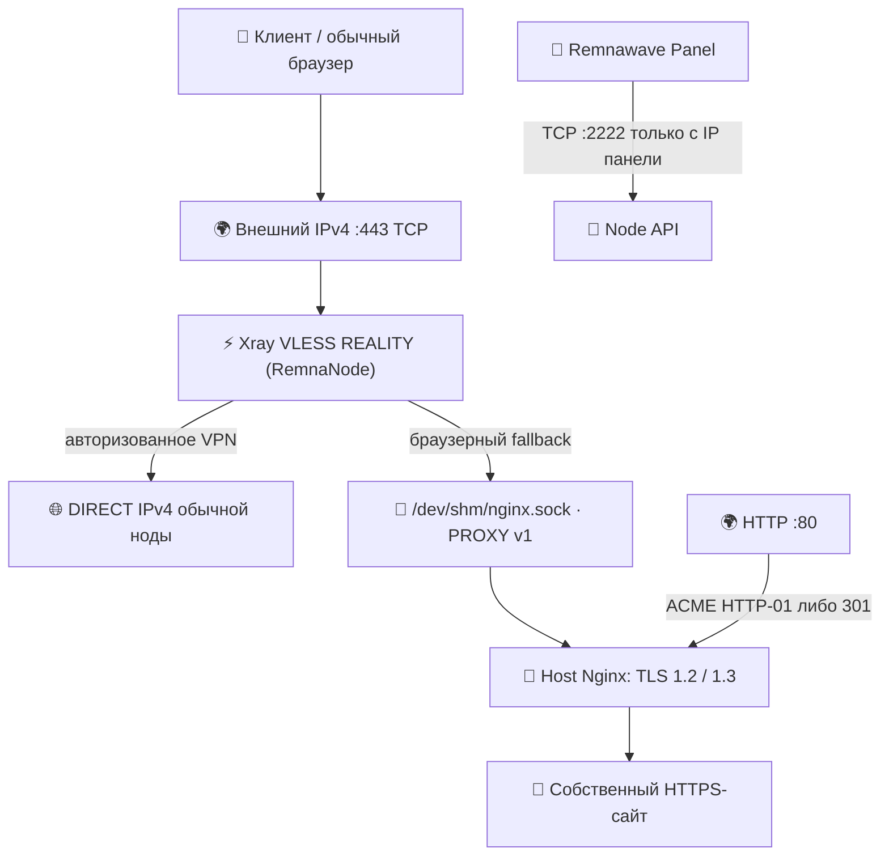
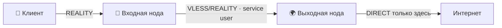

<a id="install"></a>
## ⚡ УСТАНОВКА VKARMANI NODE INSTALL 2.5.10 — ИЗ ЭТОГО ZIP

```bash
# На НОВОЙ выделенной VPS: загрузить туда скачанный полный ZIP и распаковать.
unzip Node_Install_2.5.10-docs-menu_20261015-r7d-readme.zip
cd Node_Install
python3 scripts/verify_release.py --root .
sha256sum --check SHA256SUMS
sudo bash ./install.sh --no-reboot
```

**Обновление README r7d (15.10.2026, только документация):** Уточнена навигация и границы применимости возможностей r7c; исполняемые файлы и их поведение не менялись.

**Дополнение r7c (15.10.2026):** Добавлен управляемый rollout и rollback всех шести тем сайта, loopback TCP stream Nginx и реальный клиентский SOCKS5 HTTPS/UDP-DNS probe (baseline → Exit outage → recovery) без автоматической остановки серверов. В r7c дополнительно проверяется фактическая DNS A-запись, а при rollback сохраняются исходные права файлов. Это **не** результат испытания на двух VPS; см. [подробные команды и безопасность](docs/R7_SITES_TCP_AND_LIVE_PROBES.md).

**История r6 (15.10.2026):** проверка нормализованных объектов TEST Remnawave Panel v3 (включая `vlessUuid`), cold-config аудит через RemnaNode CLI, исключение проверенного IPv4 Entry в RKN на Exit, локальный ограниченный backup с проверкой контрольных сумм. [Подробные безопасные команды, ограничения и незакрытые live-gates](docs/R6_CASCADE_OPERATIONS_AND_GATES.md). **Ни одно из этих изменений не делает выпуск production-ready.** Автоматическое создание объектов панели и бесшовная ротация ключей всё ещё не реализованы; нужны две staging VPS и реальная тестовая Panel.

> [!CAUTION]
> **2.5.10 / r7d (документация поверх r7c) — локальный непубликованный staging-кандидат.** Статус: **2.5.10 — локальный непубликованный staging**. Команда работает только после загрузки ZIP на VPS. Не запускайте первичную установку на техничке, сервере панели, действующем каскаде или работающей ноде: установщик изменяет SSH, firewall, Docker, Nginx, systemd и GRUB. До запуска: проверенный snapshot, консоль провайдера и рабочий пароль SSH. После установки обязательны проверка сети и контролируемый reboot. Сам ZIP необходимо получить из доверенного источника и проверить по отдельно выданному SHA-256.

**Первый вопрос новой установки:** `1 — Обычная нода` или `2 — Каскад`. В r5 добавлен выбор Entry/Exit и установка каждой роли **на отдельную чистую staging VPS** с собственным закрытым пакетом ключей. Генерируются независимые рабочие шаблоны REALITY. Это **не** автоматическое создание двух Node/Host/Squad в Remnawave Panel и **не** подтверждение live-каскада: назначение выполняется отдельно в тестовой панели, затем обязательна реальная двухсерверная проверка. [Точная процедура](docs/CASCADE_R5_ROLE_INSTALL_AND_PANEL.md).

**Новое в r5:** `integrations/cascade_deployment.py` готовит проверенные REALITY-пары и разделяет секреты; `install.sh` устанавливает Entry/Exit как разные роли, сохраняет неизменяемое состояние и использует их профили вместо ordinary DIRECT. `integrations/cascade_panel_audit.py` проверяет вычисленный Panel JSON без его изменения. Рабочая ordinary-ветка остаётся прежней. **Прежнее r4:** [матрица восьми направлений](docs/R4_8_POINT_ENGINEERING_20261015.md), [сайты и proxy](docs/COVER_VARIANTS_AND_PROXY_R4.md). Для r5: [установка, назначение в Panel и тесты](docs/CASCADE_R5_ROLE_INSTALL_AND_PANEL.md). **Ни одна новая функция не включается автоматически на существующей ноде; real VPS / Panel / E2E пока не проверялись.**

**Примеры без выполнения установки:**

```bash
python3 scripts/cover_variants.py --list
python3 scripts/staging_acceptance.py --help
python3 integrations/cascade_profiles.py --help
python3 integrations/cascade_deployment.py --help
python3 integrations/cascade_panel_audit.py --help
python3 integrations/panel_acl_audit.py --help
python3 scripts/nginx_proxy_plan.py --help
python3 scripts/staging_web_deploy.py --help
python3 scripts/cascade_live_probe.py --help
```

**GitHub:** в публичном `main` сейчас опубликована **2.5.9** (`3a4d277e2d9d0f80671656a917409efeade781f6`), а не эта 2.5.10. Команда GitHub для 2.5.10 будет допустима только после публикации и проверки точного commit и SHA. [Проверенная опубликованная команда 2.5.9](#github-install).

---

<div align="center">

# 🚀 VKARMANI · NODE INSTALL

**Инсталлер выделенной ноды Remnawave — с проверяемыми границами безопасности**

🛡️ IPv4-only · ⚡ VLESS REALITY + Vision · 🌐 Nginx Selfsteal · 🧩 RAW / XHTTP · 🔄 RKN Guard · 🧰 Диагностика и откат

**`2.5.10 r7d` · README актуализирован · функциональная база r7c · staging only**

[⚡ Установка](#install) · [🔀 Роли](#roles) · [🗺️ Архитектура](#architecture) · [📋 Профили](#inbounds) · [⛓️ Каскад](#cascade) · [🌐 Шесть сайтов / TCP / live QA](#sites-tcp-probes) · [🔐 Security](SECURITY.md) · [🛠️ Эксплуатация](#operations)

</div>

---

<a id="navigation"></a>
## 🗺️ Навигация

| 🚀 Начало | 🌐 VPN и панель | 🛡️ Защита | 🧰 Эксплуатация |
|:--|:--|:--|:--|
| [Режимы установки](#roles) | [Remnawave Panel](#panel) | [Сетевая схема](#architecture) | [Команды](#operations) |
| [Условия](#requirements) | [RAW + Vision](#raw) | [RKN Guard](#rkn) | [Проверка и восстановление](#verification) |
| [Опубликованная команда](#github-install) | [XHTTP](#xhttp) | [TLS/443/HSTS](#selfsteal) | [Версии/обновления](#versions) |
| [Что реализовано](#features) | [Каскад: профили](#cascade) | [Порты и SSH](#firewall) | [Известные ограничения](#limits) |
| [Шесть тем / TCP](#sites-tcp-probes) | [Проверка живого клиента](#sites-tcp-probes) | [Процедура r7c](docs/R7_SITES_TCP_AND_LIVE_PROBES.md) | [Приёмка на VPS](#verification) |

<a id="roles"></a>
## 🔀 Первый вопрос: обычная нода или каскад?

```text
VKarmani Node Install 2.5.10 — выбор режима первой установки:
  1 — Обычная нода (доступна в этой версии)
  2 — Каскад: выбрать entry/exit и путь к закрытому role-bundle.json
Выберите 1 или 2:
```

- **1 — Обычная нода.** Далее сохраняются три исходных вопроса: `SECRET_KEY` панели (скрытый ввод), домен ноды, публичный исходящий IPv4 технички. Публичный IPv4 самой VPS выбирается автоматически из реальных интерфейсов и DNS. После положительных проверок нода готова к настройке объектов в Panel; это не обещает готовое VPN-подключение без панели и клиента.
- **2 — Каскад.** На **новой чистой staging VPS** выбираются роль `entry`/`exit` и заранее подготовленный закрытый `role-bundle.json` этой VPS. Проверяются REALITY ключи, FQDN/IPv4, до APT сохраняется неизменяемый ролевой state; генерируются RAW+REALITY профиль и собственный Selfsteal на **каждом** сервере. Входной Xray не имеет DIRECT outbound. Никакие существующие inbound не переписываются. **Назначение** двух Node, Config Profiles, Host и отдельных Squads/service-user в тестовой Panel остаётся **ручным**; итоговая сеть не проверена на реальных VPS. [Команды](docs/CASCADE_R5_ROLE_INSTALL_AND_PANEL.md).

При повторном запуске на завершённой ordinary-ноде выбор роли не появляется: запускается существующая диагностика. При незавершённой установке используется защищённый механизм продолжения, роль не переключается. Если указать неверный пункт, установщик повторяет запрос ограниченное число раз. Для интерактивного запуска требуется доступный `/dev/tty`.

> [!IMPORTANT]
> **Нельзя обещать рабочий каскад только потому, что есть inbound JSON.** Remnawave Panel управляет списком `clients` и активными профилями; простая запись файла на VPS не назначает service-user, Host, Squad и двухузловую маршрутизацию.

<a id="features"></a>
## 🧩 Реально реализованные возможности 2.5.10

| Компонент | Обычная нода | Вход каскада | Выход каскада |
|:--|:--|:--|:--|
| Установка Ubuntu/Debian, Docker + RemnaNode | ✅ генератор | ✅ отдельная staging-ветка | ✅ отдельная staging-ветка |
| VLESS RAW/REALITY/Vision | ✅ один listener 443 | ✅ ролевой профиль | ✅ ролевой профиль |
| XHTTP/REALITY вместо RAW | ✅ подготовка профиля вручную | ❌ отключён для каскада | ❌ отключён для каскада |
| Собственный Nginx + Selfsteal + Let's Encrypt | ✅ для ordinary | ✅ код установки | ✅ код установки |
| UFW/Fail2ban/RKN и Node Port ACL | ✅ предусмотрены | ✅ код, live не проверено | ✅ код, peer/RKN live gate |
| Ночной restart контейнера по Москве | ✅ для новых ordinary | 🛑 пропускается до координации | 🛑 пропускается до координации |
| Config backup, image/cover rollback и диагностика | ✅ ограниченно | ✅ ролевой state, частичный rollback | ✅ ролевой state, частичный rollback |
| Защищённый peer и отсутствие DIRECT fallback | Не требуется | ✅ шаблон и offline policy audit | ✅ inbound только bridge (через Panel) |

✅ означает **реализовано в исходниках**, но не подтверждает живую VPS-приёмку. 🛑 — намеренно заблокировано. ❌ — не реализовано/не подходит данному режиму. Назначение объектов тестовой Remnawave Panel и сквозная приёмка ещё требуются.

<a id="sites-tcp-probes"></a>
## 🌐 Шесть сайтов, локальный Nginx TCP и реальные клиентские проверки

**Функциональность r7c (без изменений в r7d).** В `cover-variants/` находятся **шесть** HTML/CSS-тем: `01-atelier`, `02-archive`, `03-observatory`, `04-fieldnotes`, `05-readingroom`, `06-foundry`. `scripts/staging_web_deploy.py` устанавливает **одну выбранную тему на существующий FQDN тестовой ноды** и поддерживает проверяемый `site-rollback`; шесть сайтов одновременно на шести доменах эта команда **не** поднимает. Валидация уже установленного Selfsteal и `nginx -t` обязательна. Нельзя параллельно использовать legacy `--update-cover` без отката r7-сайта.

Для TCP есть отдельный `tcp-deploy`: **только `127.0.0.1:LISTEN → 127.0.0.1:BACKEND`**, с зарезервированными портами 80, 443, 2222 вне его области применения. Модуль `nginx stream` и реальный локальный backend должны быть доступны **заранее**; установка пакетов, создание публичного TCP endpoint и изменение Xray:443 не выполняются. Перед применением нужны snapshot, доступ к консоли и собственная завершённая staging-установка.

Тестировщик `scripts/cascade_live_probe.py` проверяет HTTPS с внешним IPv4 **Exit**, DNS A через SOCKS5 UDP ASSOCIATE и отдельный UDP echo через **реальный тестовый VPN-клиент**. Для проверки отказоустойчивости требуются три последовательные фазы `baseline → outage → recovery`; остановка **только тестового Exit** выполняется и документируется оператором отдельно. Скрипт не отключает VPS и не доказывает отсутствие утечек DNS/DIRECT на Entry без дополнительных packet capture. На текущей сборке настоящие два VPS/Panel/клиент не тестировались.

Безопасное знакомство с командами **без изменения VPS**:

```bash
python3 scripts/cover_variants.py --list
python3 scripts/staging_web_deploy.py --help
python3 scripts/cascade_live_probe.py --help
```

**Полный runbook** с `status`, `site-deploy`, `site-rollback`, `tcp-deploy`, `tcp-rollback` и параметрами фаз клиента: [R7 — сайты, TCP и real-client tests](docs/R7_SITES_TCP_AND_LIVE_PROBES.md). **Использовать только на выделенной staging-инфраструктуре**, не на рабочей ноде или техничке.

<a id="requirements"></a>
## ✅ Перед установкой обычной ноды

| Требование | Проверка |
|:--|:--|
| 🐧 ОС | **Ubuntu 22.04/24.04/26.04**, **Debian 12/13**, выделенная VPS, `systemd` + GRUB, `amd64` либо `arm64`; поддержка в коде не равна полноценной VM-проверке каждой системы |
| 💽 Ресурсы | ≥900 MiB RAM (для 26.04 ≥1536 MiB) и ≥6 GiB свободного места; нужен достаточный запас под образы и копии |
| 🌐 IPv4 и DNS | Публичный IPv4 на VPS, A-запись выбранного FQDN на него, без обязательной поддержки IPv6; NAT-only/контейнерные VPS не поддержаны |
| 🔐 SSH | Подтверждённый root/sudo и пароль SSH, внешний доступ к консоли/снимку провайдера; код может отключить вход по ключу |
| 🔌 Порты | Фактический SSH-порт, **80/tcp** для ACME/301, **443/tcp** для Xray; Node Port по умолчанию **2222/tcp**, только от backend IPv4 панели |
| 🛡️ Нельзя затрагивать | Живую панель/БД, чужую конфигурацию Nginx/UFW, существующие inbound/каскады и чужие контейнеры |

**Без автоматического reboot:** `sudo bash ./install.sh --no-reboot`. При запуске без этого флага успешная первичная установка может инициировать одноразовую перезагрузку. Всегда проверьте доступность консоли до изменения SSH/firewall.

<a id="architecture"></a>
## 🗺️ Как устроено подключение



Клиентский 443 принадлежит **Xray**, а не Nginx. REALITY обслуживает аутентифицированный трафик; неподходящий TLS передаётся в **локальный** Nginx через Unix-сокет `/dev/shm/nginx.sock` (`xver=1`). Nginx не дешифрует авторизованную VPN-сессию и не заменяет Xray; публичный TCP-stream multiplexer здесь **не установлен**.

<a id="selfsteal"></a>
### 🌐 Selfsteal, TLS 1.2/1.3 и HTTP 301

- HTTPS Selfsteal на собственном домене: TLS **1.2 и 1.3**, сертификат Let's Encrypt на хосте и заголовок `Strict-Transport-Security: max-age=300` с `always`, **без** `includeSubDomains`/`preload`.
- HTTP/80 возвращает `301` на HTTPS для корректного домена; ACME HTTP-01 должен сохранять доступ к challenge. Для неизвестного Host не обещается redirect.
- После установки проверяются конфигурация Nginx, локальный сайт, Xray/listener, сертификат и ожидаемые заголовки. **Внешние** браузер и VPN-клиент проверяются отдельно; offline PASS не доказывает доступ из конкретной сети.
- Vision относится к **RAW + REALITY**, не добавляйте его в XHTTP механически; это альтернативные профили, а не два автоматически работающих listener на одном 443.

Подробнее: [`docs/EDGE_HARDENING_2.5.8.md`](docs/EDGE_HARDENING_2.5.8.md), [`docs/SELFSTEAL_2.2.0.md`](docs/SELFSTEAL_2.2.0.md).

<a id="firewall"></a>
### 🔐 Firewall, SSH и управление

| Порт/адрес | Процесс | Доступ |
|:--|:--|:--|
| Фактический SSH-порт | `sshd` | По сохранённой парольной политике проекта; проверьте до reboot |
| `80/tcp` | Host Nginx | ACME/redirect с учётом ограничений RKN |
| `443/tcp` | Xray | Публичный TLS/REALITY; **не** добавляйте второй listener Nginx |
| `2222/tcp` по умолчанию | RemnaNode API | **Только IP backend-панели**, не `0.0.0.0/0` |
| Unix-socket, системные API | Host Nginx / Docker local | Непубличные; доступ ограничен владельцем и конфигурацией |

Cover/REALITY **не гарантируют** защиту от блокировок и не являются невидимыми для DPI.

RKN Guard — дополнительная фильтрация scanner IPv4 по источнику и ipset. **Он не гарантирует предотвращение блокировок IP/подсетей.** Проверяйте реальный UFW и firewall провайдера с внешних разрешённых и посторонних источников. Исключение IP панели в RKN **не заменяет** основной allowlist Node Port.

<a id="panel"></a>
## 🔑 Remnawave Panel: что настраивать после установки

1. На VPS получить закрытую инструкцию `sudo cat /etc/vkarmani-node/PANEL-SETUP.txt` (не публиковать её и `reality.json`).
2. Создать в Panel объект **Node**: фактический IPv4/Node Port, именно его `SECRET_KEY` и разрешённый backend IPv4 панели.
3. Создать **Config Profile** с одним VLESS inbound (RAW+REALITY+Vision либо совместимый XHTTP) и назначить его объекту Node.
4. В **Hosts** связать актуальный `inboundTag`, FQDN, SNI, publicKey, shortId и остальные параметры выбранного транспорта. Назначить **Internal Squad** и пользователей. Сам установщик не использует административный токен панели для создания этих объектов.
5. Проверить на клиенте: подписка → TLS/REALITY handshake → маршрутизация → DNS → внешний IPv4; отдельно — Panel → Node API.

Установщик создаёт локальные шаблоны в `/etc/vkarmani-node/profile.json` и, по специальной команде, `profile-xhttp.json`. **Активный профиль назначает Panel**, не локальное копирование этих файлов. `clients: []` в шаблоне — штатная модель управления клиентами через панель.

<a id="inbounds"></a>
## 📋 Полные примеры ordinary inbound для панели

Публичные примеры ниже содержат демонстрационные значения `REPLACE_WITH_*`, `example.com` и IP тестовой документации. **Их нельзя импортировать без замены ключей, тегов, адресов и проверки совместимости со своим `rw-core`.** Для реальной ноды предпочтительны собственные сгенерированные файлы из закрытого каталога VPS.

<a id="raw"></a>
### ⚡ Вариант A: VLESS + RAW + REALITY + Vision

[`examples/inbound-raw-full.example.json`](examples/inbound-raw-full.example.json) — полная обучающая конфигурация. Выставление `flow=xtls-rprx-vision` применяется к RAW, не XHTTP.

<!-- BEGIN RAW FULL EXAMPLE -->

```json
{
  "log": {
    "loglevel": "warning"
  },
  "dns": {
    "servers": [
      "1.1.1.1",
      "1.0.0.1",
      "8.8.8.8"
    ],
    "queryStrategy": "UseIPv4",
    "disableCache": false,
    "serveStale": true,
    "serveExpiredTTL": 3600,
    "enableParallelQuery": true
  },
  "inbounds": [
    {
      "tag": "VK_RAW_REALITY_REPLACE_WITH_NODE_TAG",
      "listen": "0.0.0.0",
      "port": 443,
      "protocol": "vless",
      "settings": {
        "clients": [],
        "decryption": "none",
        "flow": "xtls-rprx-vision"
      },
      "sniffing": {
        "enabled": true,
        "routeOnly": true,
        "destOverride": [
          "http",
          "tls",
          "quic"
        ]
      },
      "streamSettings": {
        "network": "raw",
        "security": "reality",
        "realitySettings": {
          "show": false,
          "target": "/dev/shm/nginx.sock",
          "xver": 1,
          "minClientVer": "0.0.0",
          "spiderX": "/",
          "serverNames": [
            "node.example.com"
          ],
          "privateKey": "REPLACE_WITH_PRIVATE_KEY_FROM_NODE",
          "shortIds": [
            "REPLACE_WITH_SHORT_ID_FROM_NODE"
          ]
        }
      }
    }
  ],
  "outbounds": [
    {
      "tag": "DIRECT",
      "protocol": "freedom",
      "settings": {
        "domainStrategy": "UseIPv4",
        "finalRules": [
          {
            "ip": [
              "geoip:private",
              "::/0"
            ],
            "action": "block"
          }
        ]
      }
    },
    {
      "tag": "BLOCK",
      "protocol": "blackhole"
    }
  ],
  "routing": {
    "domainStrategy": "IPOnDemand",
    "rules": [
      {
        "type": "field",
        "protocol": [
          "bittorrent"
        ],
        "outboundTag": "BLOCK"
      },
      {
        "type": "field",
        "domain": [
          "geosite:private"
        ],
        "outboundTag": "BLOCK"
      },
      {
        "type": "field",
        "ip": [
          "geoip:private",
          "0.0.0.0/8",
          "10.0.0.0/8",
          "100.64.0.0/10",
          "127.0.0.0/8",
          "169.254.0.0/16",
          "172.16.0.0/12",
          "192.168.0.0/16",
          "224.0.0.0/4",
          "240.0.0.0/4",
          "203.0.113.10/32",
          "::/0",
          "198.51.100.20/32"
        ],
        "outboundTag": "BLOCK"
      }
    ]
  }
}
```

<!-- END RAW FULL EXAMPLE -->

<a id="xhttp"></a>
### 🌐 Вариант B: VLESS + XHTTP + REALITY (без Vision)

[`examples/inbound-xhttp-full.example.json`](examples/inbound-xhttp-full.example.json) — **альтернатива RAW**, а не второй автоматически включённый inbound на 443. Подготовить на завершённой ordinary-ноде: `sudo bash ./install.sh --prepare-xhttp`. Подробный порядок и обратимость: [`docs/TRANSPORT_SWITCHING_2.5.4.md`](docs/TRANSPORT_SWITCHING_2.5.4.md).

<!-- BEGIN XHTTP FULL EXAMPLE -->

```json
{
  "log": {
    "loglevel": "warning"
  },
  "dns": {
    "servers": [
      "1.1.1.1",
      "1.0.0.1",
      "8.8.8.8"
    ],
    "queryStrategy": "UseIPv4",
    "disableCache": false,
    "serveStale": true,
    "serveExpiredTTL": 3600,
    "enableParallelQuery": true
  },
  "inbounds": [
    {
      "tag": "VK_RAW_REALITY_REPLACE_WITH_NODE_TAG",
      "listen": "0.0.0.0",
      "port": 443,
      "protocol": "vless",
      "settings": {
        "clients": [],
        "decryption": "none",
        "flow": ""
      },
      "sniffing": {
        "enabled": true,
        "routeOnly": true,
        "destOverride": [
          "http",
          "tls",
          "quic"
        ]
      },
      "streamSettings": {
        "network": "xhttp",
        "security": "reality",
        "realitySettings": {
          "show": false,
          "target": "/dev/shm/nginx.sock",
          "xver": 1,
          "minClientVer": "0.0.0",
          "spiderX": "/",
          "serverNames": [
            "node.example.com"
          ],
          "privateKey": "REPLACE_WITH_PRIVATE_KEY_FROM_NODE",
          "shortIds": [
            "REPLACE_WITH_SHORT_ID_FROM_NODE"
          ]
        },
        "xhttpSettings": {
          "host": "node.example.com",
          "path": "/REPLACE_WITH_NODE_GENERATED_XHTTP_PATH",
          "mode": "auto"
        }
      }
    }
  ],
  "outbounds": [
    {
      "tag": "DIRECT",
      "protocol": "freedom",
      "settings": {
        "domainStrategy": "UseIPv4",
        "finalRules": [
          {
            "ip": [
              "geoip:private",
              "::/0"
            ],
            "action": "block"
          }
        ]
      }
    },
    {
      "tag": "BLOCK",
      "protocol": "blackhole"
    }
  ],
  "routing": {
    "domainStrategy": "IPOnDemand",
    "rules": [
      {
        "type": "field",
        "protocol": [
          "bittorrent"
        ],
        "outboundTag": "BLOCK"
      },
      {
        "type": "field",
        "domain": [
          "geosite:private"
        ],
        "outboundTag": "BLOCK"
      },
      {
        "type": "field",
        "ip": [
          "geoip:private",
          "0.0.0.0/8",
          "10.0.0.0/8",
          "100.64.0.0/10",
          "127.0.0.0/8",
          "169.254.0.0/16",
          "172.16.0.0/12",
          "192.168.0.0/16",
          "224.0.0.0/4",
          "240.0.0.0/4",
          "203.0.113.10/32",
          "::/0",
          "198.51.100.20/32"
        ],
        "outboundTag": "BLOCK"
      }
    ]
  }
}
```

<!-- END XHTTP FULL EXAMPLE -->

<a id="cascade"></a>
## ⛓️ Каскад: вход и выход, что реально подготовлено



**Ролевой установочный процесс r5 реализован только для новых staging VPS; E2E и автоматическая Panel-привязка НЕ подтверждены.** Старые два JSON ниже — **лишь справочные примеры**, **не** использовать их для установки. Рабочие приватные профили генерирует `cascade_deployment.py` + `install.sh --cascade-role` по реальным ключам:

| Роль | Файл | Суть |
|:--|:--|:--|
| 🧭 Входная | [`cascade-entry-profile.reference.json`](examples/cascade-entry-profile.reference.json) | Клиентский inbound REALITY + outbound `TO_EXIT_VLESS`; первое исходящее правило — BLOCK; для клиентского inbound только `TO_EXIT_VLESS`, без `DIRECT` |
| 🌍 Выходная | [`cascade-exit-profile.reference.json`](examples/cascade-exit-profile.reference.json) | Собственный REALITY inbound и Selfsteal target; выход в интернет только после авторизации peer, которую **назначает Panel** |

Каждая нода должна иметь собственные FQDN, сертификат, REALITY ключи и локальный сайт; повторно использовать чужой privateKey нельзя. На выходе в Panel нужен **отдельный служебный пользователь** с разрешением лишь для bridge inbound, через нужный Internal Squad; его UUID/параметры должны использоваться в outbound входа. Пара `clients: []` заполняется Remnawave, а не инсталлером. Нужны проверка route/ACL, отказ при недоступном выходе и фактическое совпадение внешнего IP клиента с выходной нодой. Профили сами не создают ни Node, ни Host, ни service user в панели.

**Не устанавливайте по справочным JSON production-серверы:** значения в примерах условны; сочетание с динамическими правилами Panel и Node Plugins не проходило двухсерверную приёмку. [Ролевой установщик r5](docs/CASCADE_R5_ROLE_INSTALL_AND_PANEL.md) · [Архитектурный справочник](docs/CASCADE_REFERENCE_2.5.10.md) · [Официальная схема server routing Remnawave](https://docs.rw/learn-en/server-routing/).

<a id="rkn"></a>
## 🛡️ RKN Guard: что защищает и как диагностировать

- Использует CIDR-данные и ipset на **обычной ноде**, с исключением фактического IPv4 панели. Обновление по расписанию не равно обновлению кода стороннего проекта.
- Исправления 2.5.9 проверяют содержимое активного scanner-ipset и набора исключений панели, откатывают `before.rules` и состояние обновления при контролируемых сбоях; ошибка или неактуальный список не должны обозначаться полным PASS.
- **Отказ обновления списка не должен выключать базовый UFW**. При смене IP панели нужно отдельно обновить RKN и основной UFW Node Port ACL.

```bash
sudo bash ./install.sh --rkn-status
sudo bash ./install.sh --rkn-update
sudo bash ./install.sh --rkn-sync-panel
# Только после snapshot и проверки консоли/SSH, не для эксперимента на production:
# sudo bash ./install.sh --rkn-disable
```

См. [RKN reliability](docs/RKN_FAILSAFE_2.5.9.md), [integrated RKN](docs/RKN_GUARD_2.5.3.md), [Security](SECURITY.md).

<a id="operations"></a>
## 🛠️ Команды обслуживания из CLI 2.5.10

Все команды с `--...` ниже выполняются из папки распакованного **этого** архива либо из проверенного сохранённого `install.sh` той же версии. Они не означают автоматическое обновление уже установленных серверов.

| Команда | Что делает / ограничение |
|:--|:--|
| `sudo bash ./install.sh --check` | Запускает установленный checker, не сквозной VPN E2E |
| `sudo bash ./install.sh --maintenance-status` | Статус timer и последней ночной операции |
| `sudo bash ./install.sh --maintenance-enable` | Таймер для завершённой поддерживаемой ordinary-ноды |
| `sudo bash ./install.sh --maintenance-disable` | Отключение timer без рестарта VPS |
| `sudo bash ./install.sh --backup` | **Config-only**, не snapshot VPS и не копия объектов панели |
| `sudo bash ./install.sh --refresh-image` | Узкое обновление образа RemnaNode |
| `sudo bash ./install.sh --rollback-image` | Откат образа в поддерживаемой транзакции |
| `sudo bash ./install.sh --update-cover` | Узкое обновление сайта, не REALITY/панели |
| `sudo bash ./install.sh --rollback-cover` | Откат сайта, если штатный backup валиден |
| `sudo bash ./install.sh --finish-install` | Только собственная записанная финальная фаза **2.5.10** |
| `sudo bash ./install.sh --diagnose-resources --seconds 10 --strict` | Строгая локальная диагностика CPU/RAM/процессов |
| `sudo bash ./install.sh --prepare-xhttp` | Готовит *альтернативный* XHTTP JSON, без переключения активной Panel |
| `sudo bash ./install.sh --xray-versions --offline` | Показывает локальную информацию, ничего не обновляет |

### 🌙 Ночной перезапуск

Для **новых обычных** нод systemd планирует один перезапуск контейнера RemnaNode между **03:00 и 03:59:59 Europe/Moscow** с сохраняемым разбросом; пропущенное окно не догоняется днём, ручная остановка контейнера учитывается. **Активные VPN-соединения могут прерываться**. Каскадное расписание с разносом пары отсутствует. Нельзя путать успешный Docker restart с проверкой панели/клиента.

<a id="verification"></a>
## ✅ Проверки, диагностика и безопасное восстановление

```bash
bash -n install.sh
bash install.sh --version
python3 scripts/verify_release.py --root .
sha256sum --check SHA256SUMS
bash tests/run.sh
# Только на вашей тестовой VPS, после установки:
sudo nginx -t
sudo ufw status verbose
sudo ss -lntp
sudo bash ./install.sh --check
```

**Первичная приёмка по уровням:** сохранилась SSH-сессия и доступна новая → firewall закрывает Node Port для посторонних → 80 отдаёт 301 и ACME работает → 443 отдаёт собственный сертификат/сайт по TLS 1.2/1.3 → панель управляет нодой → клиент подключается и выдаёт ожидаемый внешний IP → после reboot всё сохраняется. Каждый уровень отмечается отдельно; ни одно локальное состояние не объявлять доказательством следующего.

Если была изменена конфигурация Panel Host или inbound, вернуть её **через панель**. При update образа/cover использовать их узкие rollback только при проверенном состоянии. При потере доступа, повреждении firewall, загрузки ОС или GRUB требуется console/snapshot; config-only backup не восстанавливает диск. **Не выполнять разрушительные тесты на production.** [Операционный runbook](docs/OPERATIONS.md).

<a id="github-install"></a>
## 📦 Уже опубликованная версия GitHub 2.5.9 (НЕ 2.5.10)

Ниже **отдельная** команда для репозитория в состоянии commit `3a4d277e2d9d0f80671656a917409efeade781f6`. Она устанавливает **только 2.5.9**, без нового меню и примеров каскада, и не является командой установки текущего ZIP 2.5.10.

```bash
curl --fail --silent --show-error --location --proto '=https' --proto-redir '=https' \
  --connect-timeout 15 --max-time 180 \
  'https://raw.githubusercontent.com/SUXARIK-GITHUB/Node_Install/3a4d277e2d9d0f80671656a917409efeade781f6/install.sh' \
  -o install-2.5.9.sh
printf '%s  %s\n' 'f61e219fc58035a29ad8be99713378fb464fe7e36d1cd7bee8d3e74a9ae701f0' 'install-2.5.9.sh' | sha256sum --check
bash -n install-2.5.9.sh
bash install-2.5.9.sh --version
# Только после snapshot и проверки окружения:
# sudo bash install-2.5.9.sh --no-reboot
```

История проекта: стабильная основа проверок — ветка **2.5.6**, затем локальные изменения 2.5.7/2.5.8 и опубликованная **2.5.9**. Это не означает, что 2.5.10 опубликована.

Это SHA-256 **исходника `install.sh`**, совпадающего в приложенном 2.5.9 и указанном GitHub commit по blob SHA. Не заменяйте контрольную сумму хэшем случайно скачанного файла ради PASS. Репозиторий/CI не изменялись при сборке этого локального 2.5.10.

<a id="versions"></a>
## 🧬 Версии Core, обновления и релизная целостность

Не заменяйте `rw-core` из официального RemnaNode непроверенным `latest`. Сначала версионная совместимость Xray/Remnawave/Panel, snapshot, staging, контроль протоколов и откат. `scripts/verify_release.py` проверяет фактический `BUILD_MANIFEST.json` и SHA256SUMS; это **не** криптографическая подпись релиза и **не** проверка реальной VPS.

Текущая публикация 2.5.10: **только ZIP, без GitHub commit/tag/Release**. После публикации нужно пересчитать точный проверенный неизменяемый URL/хэш для GitHub-команды и заменить этот раздел; команда 2.5.9 не обновляется автоматически до 2.5.10. [Core runbook](docs/XRAY_CORE_UPDATES_2.5.5.md) · [Исторический README 2.5.4](docs/history/README_2.5.4.md) · [История изменений](CHANGELOG.md).

<a id="limits"></a>
## ⚠️ Известные ограничения и статус приёмки

- **2.5.10 r7d — staging-only, только обновление README относительно r7c.** Роли Entry/Exit, проверяемое разделение ключей, выбор одной из шести тем, loopback Nginx TCP и тестировщик сетевых фаз подготовлены в исходниках; автоматическое создание объектов Remnawave Panel и реальная двухсерверная приёмка не подтверждены.
- Каскадные ролевые профили **генерируются и локально проверяются**, но не применяются автоматически панелью. Справочные JSON в `examples/` не должны использоваться напрямую. Действующую цепочку нельзя называть fail-closed без двух настоящих серверов, внешнего клиента и проверки отказа выхода.
- Не выполнены на данном исходном снимке: реальная новая VPS установка и reboot, внешний 80/443/2222, TLS-взаимодействие Xray+Nginx, выпуск/продление сертификатов, Remnawave Panel API, подключение клиента из разных сетей и 24h soak.
- Штатные offline-тесты и проверки ZIP не покрывают всё вышеописанное. Отдельные подтверждённые результаты фиксируются **только для точного архива и его SHA-256** во внешнем QA-отчёте.

[📚 Security](SECURITY.md) · [🧰 Operations](docs/OPERATIONS.md) · [🔄 RKN guard](docs/RKN_GUARD_2.5.3.md) · [⚡ Переключение транспорта](docs/TRANSPORT_SWITCHING_2.5.4.md) · [⛓️ Каскад](docs/CASCADE_REFERENCE_2.5.10.md)

---

<div align="center">

**🚀 VKARMANI NODE INSTALL 2.5.10 r7d · 🛡️ Безопасность → 🔍 Проверка → 📈 Стабильность**

[⬆️ К установке](#install) · [🔐 Security](SECURITY.md) · [🛠️ Operations](docs/OPERATIONS.md)

</div>
