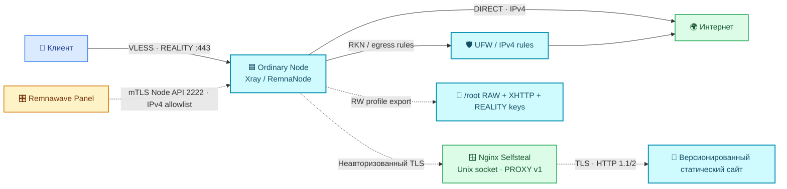
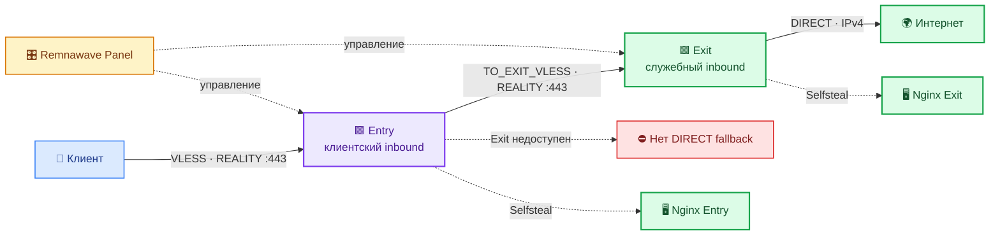

<div align="center">

# 🌌 VKARMANI · NODE INSTALL

**VLESS · REALITY · Vision · IPv4-only · Nginx Selfsteal**

**[⚡ Установка](#install) · [🟦 Обычная нода](#ordinary-map) · [🟪 Каскад](#cascade-map) · [🎛 Remnawave](#panel) · [🧪 Проверки](#verification)**

</div>

<a id="install"></a>
## ⚡ Установка

**Новая тестовая VPS, DNS A, резервная консоль и проверенный snapshot.** Установщик изменяет SSH, UFW, Docker, Nginx, systemd и GRUB.

<a id="github-install"></a>
### 🐙 1. Установка с GitHub · 2.5.14 r15 (после публикации)

**Состояние на 21.10.2026:** в публичном GitHub `main` пока находится **2.5.13 r12**, коммит `197cd273f7954a84e8445ea1d333224304777eac`. Новая версия **2.5.14 r15 пока есть только в полном ZIP ниже**. Следующая команда рассчитана на **последующую публикацию r15**. До публикации она **безопасно остановится на SHA-256** и не установит старый скрипт. Нельзя утверждать, что GitHub уже содержит r15.

**Только новая чистая staging VPS.** До выполнения: проверенный snapshot всего диска, доступ к консоли провайдера, DNS A на публичный IPv4 ноды. Выполнять от `root`:

```bash
set -Eeuo pipefail
[[ "$(id -u)" -eq 0 ]] || { echo 'ERROR: требуется root'; exit 1; }
cd /root
[[ ! -e Node_Install-2.5.14 ]] || { echo 'ERROR: каталог уже существует'; exit 1; }
git clone --depth 1 https://github.com/SUXARIK-GITHUB/Node_Install.git Node_Install-2.5.14
cd /root/Node_Install-2.5.14
printf '%s  %s\n' '6ad0f4a19a34b7814a5c6b789f542dc6129ffbc06c026d9de94051cdd4fd0419' 'install.sh' | sha256sum --check
sha256sum --check SHA256SUMS
python3 scripts/verify_release.py --root .
python3 - <<'PY_VERIFY_BUILD'
import json
from pathlib import Path
m = json.loads(Path('BUILD_MANIFEST.json').read_text(encoding='utf-8'))
if (m.get('version'), m.get('build_id'), m.get('release_status')) != (
        '2.5.14', '20261021-r15-github-install', 'INCOMPLETE_STAGING_ONLY'):
    raise SystemExit('STOP: GitHub version/build/status mismatch; installer NOT launched')
PY_VERIFY_BUILD
bash -n install.sh
[[ "$(bash ./install.sh --version)" == '2.5.14' ]] || { echo 'ERROR: installer version mismatch'; exit 1; }
bash ./install.sh
```

Установка запускается **стандартной командой `bash ./install.sh`**, без нестандартного Node Port. По умолчанию управляющий TCP/2222; клиентский REALITY TCP/443. После успешной установки выполняется предусмотренная установщиком автоматическая перезагрузка. Повторный запуск после частичной установки — только по инструкции `--finish-install` и после диагностики состояния; не обходить fail-closed проверки.

**Без публикации новой версии в GitHub команда GitHub не предназначена для выполнения.** Для тестирования именно 2.5.14 r15 используйте проверенный ZIP ниже.

<a id="archive-install"></a>
### 📁 2. Из полного ZIP · 2.5.14 r15 (текущая staging-сборка)

Полный ZIP сначала передаётся на отдельную **чистую VPS**. Проверяйте SHA-256 архива по независимому доверенному каналу. Внутренний `SHA256SUMS` удостоверяет целостность, но не происхождение архива. Перед первым запуском — snapshot целого диска и доступная аварийная консоль хостера.

```bash
set -Eeuo pipefail
[[ "$(id -u)" -eq 0 ]] || { echo 'ERROR: требуется root'; exit 1; }
unzip -q Node_Install_2.5.14-docs-menu_20261021-r15-github-install.zip
cd Node_Install
python3 scripts/verify_release.py --root .
sha256sum --check SHA256SUMS
bash -n install.sh
bash ./install.sh --version
bash ./install.sh
```

**Выбор REALITY/Selfsteal при установке новой Ordinary-ноды:**

1. `Обычный` — собственный сайт Nginx; `target=/dev/shm/nginx.sock`, `xver=1`, SNI = FQDN ноды.
2. `max.ru` — собственный HTTPS Selfsteal **плюс** passthrough TLS для выбранного `max.ru`.
3. `ya.ru` — собственный HTTPS Selfsteal **плюс** passthrough TLS для выбранного `ya.ru`.
4. `rutube.ru` — собственный HTTPS Selfsteal **плюс** passthrough TLS для выбранного `rutube.ru`.
5. `mail.ru` — собственный HTTPS Selfsteal **плюс** passthrough TLS для выбранного `mail.ru`.

Во всех режимах REALITY `target=/dev/shm/nginx.sock`, `xver=1`; у внешних режимов `serverNames` = выбранному внешнему имени. **Это Unix socket в Xray-контейнере**, физически соответствующий `/run/vkarmani-selfsteal/nginx.sock` хоста. Внешний режим устанавливает Nginx stream-модуль и разделяет TLS по разрешённым SNI: **свой FQDN → локальный HTTPS-сайт на `cover.sock`; выбранное внешнее имя → TLS passthrough без подмены сертификата**. Любой другой SNI попадает на HTTPS-default: TLS reject на поддерживаемом Nginx, иначе HTTP/421. Заголовок PROXY протокола не передаётся внешним серверам. Никакого второго публичного `443` listener Nginx не открывается: TCP/443 слушает Xray. HTTP/80 своего FQDN использует 301 → HTTPS, исключая challenge Certbot.

**Порты по умолчанию:** RemnaNode Node API слушает TCP/2222 (доступ только для разрешённых IPv4 панели); RAW/XHTTP REALITY использует TCP/443, а HTTP-01 ACME — TCP/80. Отдельный механизм выбора порта новой Ordinary-ноды технически сохранён в коде, но **в этой инструкции используется только стандартная установка, без его параметров**. Для действующих нод автоматическая смена портов не предусмотрена. Изменение клиентского 443 требует отдельной согласованной миграции и проверки у провайдеров.

Внешний SNI **не обеспечивает «невидимость VPN»** и не гарантирует прохождение фильтрации по IP, ASN или TLS. Перед установкой тестируется доступность реального IPv4/TLS 1.3 внешнего ресурса. RAW и XHTTP — *альтернативные* конфиги одного TCP/443 listener, с одинаковыми Reality privateKey/shortIds, но разными транспортами/flow; применять вместе на одном `443` нельзя. Клиентский `Address` = свой реальный адрес ноды; внешний SNI = выбор режима. Каскад Entry/Exit и его собственный локальный Selfsteal не переделаны. Смена режима или портов действующей ноды установщиком не поддерживается.

[Изменения r15 и порядок публикации через GitHub](docs/RELEASE_2.5.14_R15_GITHUB_INSTALL_20261021.md) · [Runbook r14: гибридный Selfsteal и испытания](docs/RELEASE_2.5.13_R14_HYBRID_SELFSTEAL_20261021.md).

После **успешной Ordinary-установки** доступны приватные файлы `root:0600`:

| Путь | Назначение |
|:---|:---|
| `/root/reality-keys.txt` | PrivateKey/PublicKey/ShortID и параметры SNI |
| `/root/vkarmani-raw-profile.json` | Основной RAW + REALITY + Vision Config Profile |
| `/root/vkarmani-xhttp-profile.json` | Альтернативный XHTTP + REALITY без Vision (только при успешной проверке ядра) |

RAW и XHTTP — **альтернативы для одного входящего TCP/443**, а не два одновременных сервиса. Возможности клиента зависят от фактической поддержки ядра; универсальную совместимость обещать нельзя. Каскад Entry/Exit использует прежний отдельный процесс установки с приватными role-bundle и не получает третий файл XHTTP. Роли Entry и Exit устанавливаются на разных чистых VPS.

**VPS 1 vCPU / 1 GiB RAM:** минимум 900 MiB фактической RAM и 6 GiB свободного места; до APT требуется 1 GiB активного swap при RAM меньше 1536 MiB. Проверка реальной установки и нагрузки на отдельной 1-гигабайтной VPS остаётся обязательной.

**Релизные документы:** [r15 · версия и GitHub](docs/RELEASE_2.5.14_R15_GITHUB_INSTALL_20261021.md) · [r14 · hybrid](docs/RELEASE_2.5.13_R14_HYBRID_SELFSTEAL_20261021.md) · [r12 · 12 тем и 404](docs/RELEASE_2.5.13_R12_SITES.md) · [r11 · RAW/XHTTP](docs/RELEASE_2.5.12_R11_REVIEW.md) · [r10 · память](docs/RELEASE_2.5.11_R10_REVIEW.md). Репозиторий/серверы автоматически не обновляются. Nginx остаётся системным, IPv6 отключён по политике установки.

---

<a id="roles"></a>
## 🧩 Два режима — две карты

| 🟦 **Обычная нода** | 🟪 **Каскад Entry → Exit** |
|:---|:---|
| **Клиент → Node → Интернет** | **Клиент → Entry → Exit → Интернет** |
| Одна VPS, RAW + REALITY + Vision; XHTTP — отдельная альтернатива | Две VPS, RAW + REALITY + Vision, отдельный мостовой пользователь |
| `DIRECT` доступен на обычной ноде после фильтрации | На Entry **нет DIRECT**, выход в Интернет только с Exit |
| [🗺️ Схема](#ordinary-map) · [⚡ RAW](#raw) · [🌐 XHTTP](#xhttp) | [🗺️ Схема](#cascade-map) · [🔗 Entry и Exit JSON](#cascade) |

Установка: **режим 1 — Ordinary**, **режим 2 — каскад** с выбором роли `entry` / `exit`. Каждую роль устанавливают отдельно. Не менять роль или ключи поверх действующей ноды.

<a id="navigation"></a>
## 🧭 Быстрые переходы

| Что нужно | Где смотреть |
|:---|:---|
| Установить и выбрать роль | [GitHub / ZIP](#install) · [Требования](#requirements) |
| Настроить объекты в панели | [🎛 Remnawave](#panel) · [Ролевой runbook](docs/CASCADE_R5_ROLE_INSTALL_AND_PANEL.md) |
| Взять полный профиль Xray | [Ordinary RAW](#raw) · [Ordinary XHTTP](#xhttp) · [Entry / Exit](#cascade) |
| 🎨 Посмотреть 12 сайтов и генератор | [Темы и Selfsteal](#sites-tcp-probes) · [Тематический каталог r12](docs/RELEASE_2.5.13_R12_SITES.md) |
| 🗝 Найти три готовых приватных файла | [RAW / XHTTP / REALITY keys](#archive-install) |
| Проверить маршруты, DNS/UDP и откат | [Диагностика](#verification) · [Эксплуатация](#operations) |

<a id="requirements"></a>
### ⚙️ Перед установкой

**Чистая VPS**, глобальный IPv4, DNS A, совместимый Ubuntu/Debian, консоль провайдера и проверенный snapshot. Для Ordinary нужен `SECRET_KEY` Node и исходящий IPv4 backend панели; для каждой каскадной роли — **собственный** приватный `role-bundle.json` (`0600`). Никаких изменений на техничке, панели или работающих нодах.

<a id="architecture"></a>
<a id="ordinary-map"></a>
### 🟦 Карта 1 · Обычная нода



**Remnawave:** один Node, один активный Config Profile, публичный Host на его inbound и пользовательский Internal Squad. Выберите **RAW или XHTTP** для порта 443, не два независимых слушателя одновременно.

<a id="cascade-map"></a>
### 🟪 Карта 2 · Каскад Entry → Exit



**Remnawave:** два отдельных Node и Config Profile. Публичный Host — **только Entry**; Exit разрешён **только service-user** через собственный Internal Squad. При недоступности Exit Entry не должен выпускать клиентский трафик через свой `DIRECT`.

<a id="selfsteal"></a>
<a id="firewall"></a>
### Нельзя забывать

- Публичный Nginx HTTP/80 необходим для ACME/редиректа; сертификат и TLS нужно проверить **снаружи**, не только `nginx -t`.
- Node API/2222 разрешён **только IPv4 backend панели**, не всем; UFW, RKN, Fail2ban и SSH тестируют отдельно после reboot.
- Текущий установщик использует password-only SSH по политике проекта; потребуется сильный пароль и аварийная консоль. Не меняйте доступ вслепую.
- IPv6 выключен по политике проекта, но его отсутствие в пользовательском маршруте должно подтверждаться live capture.
- Cover/REALITY **не гарантируют** доступность из любой сети, отсутствие блокировок или обход ограничений провайдера: проверять внешними клиентами и независимыми точками.

<a id="panel"></a>
## 🎛 Remnawave · что создать в панели

В **Config Profiles** вставляют полный JSON для соответствующей роли. В **Nodes** назначают профиль и его inbound, в **Internal Squads** разрешают доступ пользователям, а в **Hosts** задают клиентский вход. <a href="https://docs.rw/learn-en/config-profiles/">Config Profiles</a> · <a href="https://docs.rw/learn-en/squads/">Internal Squads</a> · <a href="https://docs.rw/learn-en/hosts/">Hosts</a>.

| Объект Remnawave | 🟦 Обычная нода | 🟪 Каскад |
|:---|:---|:---|
| **Node** | Один Ordinary | Два: **Entry** и **Exit** |
| **Config Profile** | [RAW](#raw) либо [XHTTP](#xhttp) | [Entry JSON](#cascade-entry-json) + [Exit JSON](#cascade-exit-json), **разные профили** |
| **Активный inbound** | Уникальный `VK_RAW_*` | Уникальные `VK_CASCADE_ENTRY_*` и `VK_CASCADE_EXIT_*` |
| **Host в подписке** | Публичный Ordinary :443 | Публичный **Entry :443**; на Exit **не создавать** клиентский Host |
| **Internal Squad** | Для клиентов Ordinary | Клиенты → **Entry**; service-user → **только Exit** |
| **VLESS UUID** | Назначает Panel | На мосту Entry используется именно **VLESS UUID service-user на Exit**, а не ID записи пользователя |
| **Как подписать Host** | `🌐 VKARMANI · Ordinary` | `🔗 VKARMANI · Cascade` (для Entry) |

**Порядок:** Config Profile → Node → включить inbound → Internal Squad → пользователь / service-user → публичный Host. `clients: []` в шаблонах корректно: список заполняет Panel. Не копируйте примеры с `REPLACE_WITH_*` прямо в действующую панель — используйте профиль, созданный на вашей VPS.

**Контроль:** после назначения проверьте [фактический Xray JSON и роли](docs/R6_CASCADE_OPERATIONS_AND_GATES.md). Инструкция здесь **не подключается к вашей панели и не меняет её настройки**. Нельзя повторять существующий `inbound.tag`.

<a id="inbounds"></a>
## 📋 Готовые образцы профилей для Remnawave

Все примеры **полные Xray JSON**. Они содержат `REPLACE_WITH_*`, зарезервированные IP и демонстрационные FQDN — не реальные ключи. Для практического развертывания используйте **сгенерированный профиль своей VPS**, а примеры — для проверки структуры и правил.

<a id="raw"></a>
### ⚡ Ordinary · RAW + REALITY + Vision

RAW — основной профиль, `flow: xtls-rprx-vision`; один listener `0.0.0.0:443`. Пример совпадает с [`examples/inbound-raw-full.example.json`](examples/inbound-raw-full.example.json).

<details>
<summary><b>Показать полный RAW inbound + outbound + routing</b></summary>

<!-- BEGIN RAW FULL EXAMPLE -->

```json
{
  "log": {
    "loglevel": "warning"
  },
  "dns": {
    "servers": [
      "1.1.1.1",
      "1.0.0.1",
      "8.8.8.8"
    ],
    "queryStrategy": "UseIPv4",
    "disableCache": false,
    "serveStale": true,
    "serveExpiredTTL": 3600,
    "enableParallelQuery": true
  },
  "inbounds": [
    {
      "tag": "VK_RAW_REALITY_REPLACE_WITH_NODE_TAG",
      "listen": "0.0.0.0",
      "port": 443,
      "protocol": "vless",
      "settings": {
        "clients": [],
        "decryption": "none",
        "flow": "xtls-rprx-vision"
      },
      "sniffing": {
        "enabled": true,
        "routeOnly": true,
        "destOverride": [
          "http",
          "tls",
          "quic"
        ]
      },
      "streamSettings": {
        "network": "raw",
        "security": "reality",
        "realitySettings": {
          "show": false,
          "target": "/dev/shm/nginx.sock",
          "xver": 1,
          "minClientVer": "0.0.0",
          "spiderX": "/",
          "serverNames": [
            "node.example.com"
          ],
          "privateKey": "REPLACE_WITH_PRIVATE_KEY_FROM_NODE",
          "shortIds": [
            "REPLACE_WITH_SHORT_ID_FROM_NODE"
          ]
        }
      }
    }
  ],
  "outbounds": [
    {
      "tag": "DIRECT",
      "protocol": "freedom",
      "settings": {
        "domainStrategy": "UseIPv4",
        "finalRules": [
          {
            "ip": [
              "geoip:private",
              "::/0"
            ],
            "action": "block"
          }
        ]
      }
    },
    {
      "tag": "BLOCK",
      "protocol": "blackhole"
    }
  ],
  "routing": {
    "domainStrategy": "IPOnDemand",
    "rules": [
      {
        "type": "field",
        "protocol": [
          "bittorrent"
        ],
        "outboundTag": "BLOCK"
      },
      {
        "type": "field",
        "domain": [
          "geosite:private"
        ],
        "outboundTag": "BLOCK"
      },
      {
        "type": "field",
        "ip": [
          "geoip:private",
          "0.0.0.0/8",
          "10.0.0.0/8",
          "100.64.0.0/10",
          "127.0.0.0/8",
          "169.254.0.0/16",
          "172.16.0.0/12",
          "192.168.0.0/16",
          "224.0.0.0/4",
          "240.0.0.0/4",
          "203.0.113.10/32",
          "::/0",
          "198.51.100.20/32"
        ],
        "outboundTag": "BLOCK"
      }
    ]
  }
}
```

<!-- END RAW FULL EXAMPLE -->

</details>

<a id="xhttp"></a>
### 🌐 Ordinary · XHTTP + REALITY

Альтернатива RAW, **не второй одновременный listener на 443**. `flow` пустой, `xhttpSettings.path` генерируется самой нодой. Переключение профиля — в Panel; `--prepare-xhttp` только готовит JSON. [Runbook XHTTP](docs/TRANSPORT_SWITCHING_2.5.4.md).

<details>
<summary><b>Показать полный XHTTP inbound + outbound + routing</b></summary>

<!-- BEGIN XHTTP FULL EXAMPLE -->

```json
{
  "log": {
    "loglevel": "warning"
  },
  "dns": {
    "servers": [
      "1.1.1.1",
      "1.0.0.1",
      "8.8.8.8"
    ],
    "queryStrategy": "UseIPv4",
    "disableCache": false,
    "serveStale": true,
    "serveExpiredTTL": 3600,
    "enableParallelQuery": true
  },
  "inbounds": [
    {
      "tag": "VK_RAW_REALITY_REPLACE_WITH_NODE_TAG",
      "listen": "0.0.0.0",
      "port": 443,
      "protocol": "vless",
      "settings": {
        "clients": [],
        "decryption": "none",
        "flow": ""
      },
      "sniffing": {
        "enabled": true,
        "routeOnly": true,
        "destOverride": [
          "http",
          "tls",
          "quic"
        ]
      },
      "streamSettings": {
        "network": "xhttp",
        "security": "reality",
        "realitySettings": {
          "show": false,
          "target": "/dev/shm/nginx.sock",
          "xver": 1,
          "minClientVer": "0.0.0",
          "spiderX": "/",
          "serverNames": [
            "node.example.com"
          ],
          "privateKey": "REPLACE_WITH_PRIVATE_KEY_FROM_NODE",
          "shortIds": [
            "REPLACE_WITH_SHORT_ID_FROM_NODE"
          ]
        },
        "xhttpSettings": {
          "host": "node.example.com",
          "path": "/REPLACE_WITH_NODE_GENERATED_XHTTP_PATH",
          "mode": "auto"
        }
      }
    }
  ],
  "outbounds": [
    {
      "tag": "DIRECT",
      "protocol": "freedom",
      "settings": {
        "domainStrategy": "UseIPv4",
        "finalRules": [
          {
            "ip": [
              "geoip:private",
              "::/0"
            ],
            "action": "block"
          }
        ]
      }
    },
    {
      "tag": "BLOCK",
      "protocol": "blackhole"
    }
  ],
  "routing": {
    "domainStrategy": "IPOnDemand",
    "rules": [
      {
        "type": "field",
        "protocol": [
          "bittorrent"
        ],
        "outboundTag": "BLOCK"
      },
      {
        "type": "field",
        "domain": [
          "geosite:private"
        ],
        "outboundTag": "BLOCK"
      },
      {
        "type": "field",
        "ip": [
          "geoip:private",
          "0.0.0.0/8",
          "10.0.0.0/8",
          "100.64.0.0/10",
          "127.0.0.0/8",
          "169.254.0.0/16",
          "172.16.0.0/12",
          "192.168.0.0/16",
          "224.0.0.0/4",
          "240.0.0.0/4",
          "203.0.113.10/32",
          "::/0",
          "198.51.100.20/32"
        ],
        "outboundTag": "BLOCK"
      }
    ]
  }
}
```

<!-- END XHTTP FULL EXAMPLE -->

</details>

<a id="cascade"></a>
## ⛓️ Каскад · два независимых inbound

| Параметр | 🧭 Entry (вход) | 🌍 Exit (выход) |
|---|---|---|
| Клиенты `clients` | Управляет Panel, только тестовые клиенты | **Только мостовой service-user** через отдельный Squad |
| Transport | `raw` + `reality`, Vision | `raw` + `reality`, Vision |
| `target` и `xver` | Локальный Nginx `/dev/shm/nginx.sock`, `1` | Свой локальный Nginx `/dev/shm/nginx.sock`, `1` |
| Основной outbound | `TO_EXIT_VLESS` | `DIRECT` **после проверки bridge-user** |
| Безопасный fallback | `BLOCK` — **первый outbound** | `BLOCK` и `finalRules` для приватных IP |
| DNS | `domainStrategy: AsIs`, **без встроенного DNS** | IPv4 DNS на Exit; локальная обработка только там |
| REALITY | **Своя** пара ключей и короткий ID | **Другая** пара ключей и короткий ID |

Полные JSON ниже **синхронизированы с `integrations/cascade_profiles.py`**. Они включают inbound, outbound, правила private-IP/IPv6 block и обработку клиентских соединений. При замене всех плейсхолдеров важны совпадение UUID, публичного ключа и `shortId` Exit с мостовым outbound Entry. Разные inbound tags обязательны: дубликат `tag` Remnawave отклонит.

<a id="cascade-entry-json"></a>
### 🧭 1. Entry — клиентский inbound и мост в Exit

[Справочный JSON Entry](examples/cascade-entry-profile.reference.json) · [Ролевой генератор](integrations/cascade_profiles.py)

- **Вход:** VLESS RAW/REALITY/Vision, `0.0.0.0:443`; `clients` назначаются Panel.
- **Маршрут:** block для BitTorrent и private/IPv6, затем весь разрешённый клиентский трафик в `TO_EXIT_VLESS`. **Никакого DIRECT, DNS-resolver или balancer на Entry.**
- **Мост:** Exit IPv4:443, `service_user_uuid` именно пользователя Exit, `serverName`/`publicKey`/`shortId` **выходной** ноды.

<details>
<summary><b>Показать полный JSON Entry · inbound + TO_EXIT_VLESS + routing</b></summary>

<!-- BEGIN CASCADE ENTRY FULL EXAMPLE -->

```json
{
  "log": {
    "loglevel": "warning"
  },
  "inbounds": [
    {
      "tag": "VK_CASCADE_ENTRY_REALITY_REPLACE_WITH_REAL_TAG",
      "port": 443,
      "listen": "0.0.0.0",
      "protocol": "vless",
      "settings": {
        "clients": [],
        "decryption": "none",
        "flow": "xtls-rprx-vision"
      },
      "sniffing": {
        "enabled": true,
        "routeOnly": true,
        "destOverride": [
          "http",
          "tls",
          "quic"
        ]
      },
      "streamSettings": {
        "network": "raw",
        "security": "reality",
        "realitySettings": {
          "show": false,
          "target": "/dev/shm/nginx.sock",
          "xver": 1,
          "minClientVer": "0.0.0",
          "spiderX": "/",
          "serverNames": [
            "entry.example.com"
          ],
          "privateKey": "REPLACE_WITH_ENTRY_PRIVATE_KEY",
          "shortIds": [
            "REPLACE_WITH_ENTRY_SHORT_ID"
          ]
        }
      }
    }
  ],
  "outbounds": [
    {
      "tag": "BLOCK",
      "protocol": "blackhole"
    },
    {
      "tag": "TO_EXIT_VLESS",
      "protocol": "vless",
      "settings": {
        "vnext": [
          {
            "address": "198.51.100.20",
            "port": 443,
            "users": [
              {
                "id": "REPLACE_WITH_EXIT_SERVICE_USER_UUID",
                "encryption": "none",
                "flow": "xtls-rprx-vision"
              }
            ]
          }
        ]
      },
      "streamSettings": {
        "network": "raw",
        "security": "reality",
        "realitySettings": {
          "serverName": "exit.example.com",
          "fingerprint": "chrome",
          "publicKey": "REPLACE_WITH_EXIT_PUBLIC_KEY",
          "shortId": "REPLACE_WITH_EXIT_SHORT_ID",
          "spiderX": "/"
        }
      }
    }
  ],
  "routing": {
    "domainStrategy": "AsIs",
    "rules": [
      {
        "type": "field",
        "protocol": [
          "bittorrent"
        ],
        "outboundTag": "BLOCK"
      },
      {
        "type": "field",
        "domain": [
          "geosite:private"
        ],
        "outboundTag": "BLOCK"
      },
      {
        "type": "field",
        "ip": [
          "0.0.0.0/8",
          "10.0.0.0/8",
          "100.64.0.0/10",
          "127.0.0.0/8",
          "169.254.0.0/16",
          "172.16.0.0/12",
          "192.0.0.0/24",
          "192.0.2.0/24",
          "192.168.0.0/16",
          "198.18.0.0/15",
          "198.51.100.0/24",
          "203.0.113.0/24",
          "224.0.0.0/4",
          "240.0.0.0/4",
          "::/0"
        ],
        "outboundTag": "BLOCK"
      },
      {
        "type": "field",
        "inboundTag": [
          "VK_CASCADE_ENTRY_REALITY_REPLACE_WITH_REAL_TAG"
        ],
        "outboundTag": "TO_EXIT_VLESS"
      }
    ]
  }
}
```

<!-- END CASCADE ENTRY FULL EXAMPLE -->

</details>

<a id="cascade-exit-json"></a>
### 🌍 2. Exit — bridge inbound и фильтр выхода

[Справочный JSON Exit](examples/cascade-exit-profile.reference.json) · [Сценарий установки](docs/CASCADE_R5_ROLE_INSTALL_AND_PANEL.md)

- **Вход:** отдельный VLESS/REALITY на 443. Только назначенный **Panel service-user** из закрытого Exit Internal Squad.
- **Выход:** `DIRECT` через IPv4 после фильтров `routing` и `freedom.finalRules`, с запретом частных/служебных/IPv6 сетей; BitTorrent блокируется.
- **Fallback:** собственный Nginx и независимые REALITY ключи; **никаких** исходящих `TO_EXIT_VLESS` на Exit.

<details>
<summary><b>Показать полный JSON Exit · inbound + DIRECT + routing</b></summary>

<!-- BEGIN CASCADE EXIT FULL EXAMPLE -->

```json
{
  "log": {
    "loglevel": "warning"
  },
  "dns": {
    "servers": [
      "1.1.1.1",
      "1.0.0.1",
      "8.8.8.8"
    ],
    "queryStrategy": "UseIPv4"
  },
  "inbounds": [
    {
      "tag": "VK_CASCADE_EXIT_REALITY_REPLACE_WITH_REAL_TAG",
      "port": 443,
      "listen": "0.0.0.0",
      "protocol": "vless",
      "settings": {
        "clients": [],
        "decryption": "none",
        "flow": "xtls-rprx-vision"
      },
      "sniffing": {
        "enabled": true,
        "routeOnly": true,
        "destOverride": [
          "http",
          "tls",
          "quic"
        ]
      },
      "streamSettings": {
        "network": "raw",
        "security": "reality",
        "realitySettings": {
          "show": false,
          "target": "/dev/shm/nginx.sock",
          "xver": 1,
          "minClientVer": "0.0.0",
          "spiderX": "/",
          "serverNames": [
            "exit.example.com"
          ],
          "privateKey": "REPLACE_WITH_EXIT_PRIVATE_KEY",
          "shortIds": [
            "REPLACE_WITH_EXIT_SHORT_ID"
          ]
        }
      }
    }
  ],
  "outbounds": [
    {
      "tag": "DIRECT",
      "protocol": "freedom",
      "settings": {
        "domainStrategy": "UseIPv4",
        "finalRules": [
          {
            "ip": [
              "0.0.0.0/8",
              "10.0.0.0/8",
              "100.64.0.0/10",
              "127.0.0.0/8",
              "169.254.0.0/16",
              "172.16.0.0/12",
              "192.0.0.0/24",
              "192.0.2.0/24",
              "192.168.0.0/16",
              "198.18.0.0/15",
              "198.51.100.0/24",
              "203.0.113.0/24",
              "224.0.0.0/4",
              "240.0.0.0/4",
              "::/0"
            ],
            "action": "block"
          }
        ]
      }
    },
    {
      "tag": "BLOCK",
      "protocol": "blackhole"
    }
  ],
  "routing": {
    "domainStrategy": "IPOnDemand",
    "rules": [
      {
        "type": "field",
        "protocol": [
          "bittorrent"
        ],
        "outboundTag": "BLOCK"
      },
      {
        "type": "field",
        "domain": [
          "geosite:private"
        ],
        "outboundTag": "BLOCK"
      },
      {
        "type": "field",
        "ip": [
          "0.0.0.0/8",
          "10.0.0.0/8",
          "100.64.0.0/10",
          "127.0.0.0/8",
          "169.254.0.0/16",
          "172.16.0.0/12",
          "192.0.0.0/24",
          "192.0.2.0/24",
          "192.168.0.0/16",
          "198.18.0.0/15",
          "198.51.100.0/24",
          "203.0.113.0/24",
          "224.0.0.0/4",
          "240.0.0.0/4",
          "::/0"
        ],
        "outboundTag": "BLOCK"
      },
      {
        "type": "field",
        "inboundTag": [
          "VK_CASCADE_EXIT_REALITY_REPLACE_WITH_REAL_TAG"
        ],
        "outboundTag": "DIRECT"
      }
    ]
  }
}
```

<!-- END CASCADE EXIT FULL EXAMPLE -->

</details>

> [!CAUTION]
> Это **образцы для разбора**, не готовые для импорта: у них несуществующие приватные ключи, UUID и документационные IP. Не заменяйте автоматически весь профиль реальной панели. Для использования сначала генерируется **закрытая пара**, после чего каждая VPS получает только собственный приватный ключ. Проверка конфигурации — обязательна перед первым клиентским подключением.

<a id="cascade-setup"></a>
### 🔧 Подготовка и установка каскада на двух чистых staging VPS

На **защищённой машине оператора** с установленной зависимостью `cryptography` создайте пару, указав свои **реальные** IPv4/FQDN (не `203.0.113.0/24`, не `198.51.100.0/24`). Каталог `/root` и создаваемые bundles должны оставаться root-only:

```bash
umask 077
sudo python3 integrations/cascade_deployment.py create-pair \
  --entry-domain "$ENTRY_DOMAIN" --entry-ipv4 "$ENTRY_IPV4" \
  --exit-domain "$EXIT_DOMAIN" --exit-ipv4 "$EXIT_IPV4" \
  --output /root/cascade-private-pair.json
sudo python3 integrations/cascade_deployment.py prepare \
  --pair /root/cascade-private-pair.json \
  --output /root/cascade-private-split
```

**Разделить секреты:** на Exit передать **только** `exit/role-bundle.json`; на Entry — **только** `entry/role-bundle.json`. Не помещать закрытые JSON в Git, чат или открытые журналы.

```bash
# Сначала Exit, затем Entry; команды на РАЗНЫХ VPS.
# EXIT VPS:
sudo bash ./install.sh --cascade-role exit \
  --cascade-bundle /root/cascade/exit/role-bundle.json --no-reboot

# ENTRY VPS:
sudo bash ./install.sh --cascade-role entry \
  --cascade-bundle /root/cascade/entry/role-bundle.json --no-reboot
```

Далее назначить объекты тестовой Panel согласно [пошаговому runbook](docs/CASCADE_R5_ROLE_INSTALL_AND_PANEL.md), проверить фактический JSON командой аудитора и только затем — реальных клиентов. Автоматического создания Panel Nodes/Hosts/Squads здесь **нет**.

<a id="sites-tcp-probes"></a>
## 🌐 12 тематических сайтов · Nginx TCP · сетевые проверки

**В комплекте — 12 тем:** `01-atelier`, `02-archive`, `03-observatory`, `04-fieldnotes`, `05-readingroom`, `06-foundry`, `07-botanica`, `08-nocturne`, `09-kitchen`, `10-atlas`, `11-tides`, `12-cinema`. На одной VPS применяется **одна тема** с доменной вариативностью. Навигация — рабочие якорные разделы, несуществующие пути возвращают настоящий **HTTP 404** с собственной страницей темы. CSS, favicon, 404 и главная страница входят в один журнал восстановления.

Генератор полностью offline и не меняет Nginx. Пример предварительного просмотра: `python3 scripts/cover_variants.py --name 08-nocturne --domain preview.example.test --output /tmp/preview-nocturne-new` (каталог должен отсутствовать). Для живого деплоя на **отдельной staging VPS** используйте `site-deploy`, затем `site-rollback` по runbook — скрипт сам проверит домен, версию, Nginx и локальный Selfsteal. Не запускать на работающей production-ноде без snapshot.

```bash
python3 scripts/cover_variants.py --list
sudo python3 scripts/staging_web_deploy.py status
python3 scripts/staging_web_deploy.py --help
python3 scripts/cascade_live_probe.py --help
```

`tcp-deploy` разворачивает Nginx stream **только `127.0.0.1:LISTEN → 127.0.0.1:BACKEND`**, не открывает публичный TCP endpoint, не занимает `:443` и требует заранее установленного `nginx stream`-модуля. **На staging** следуйте [точным командам rollout/rollback](docs/R7_SITES_TCP_AND_LIVE_PROBES.md).

<a id="rkn"></a>
## 🛡️ RKN / UFW / доступ панели

RKN обновляет IP/CIDR-список, а **не код** стороннего проекта. На Exit предусмотрено исключение IPv4 Entry для связи между нодами, **без** доступа Entry к Node API. При смене IPv4 панели `--rkn-sync-panel` **не заменяет** обновление основного UFW ACL Node API.

```bash
sudo bash ./install.sh --rkn-status
sudo bash ./install.sh --rkn-update
sudo bash ./install.sh --rkn-sync-panel
```

[Подробная политика](docs/RKN_FAILSAFE_2.5.9.md) · [Состояние каскада](docs/R6_CASCADE_OPERATIONS_AND_GATES.md) · [Security](SECURITY.md).

<a id="operations"></a>
## 🛠️ CLI · эксплуатация и откат

Эти команды относятся к **своей завершённой** установке. Не заменяйте бинарники и state на уже работающей ноде другой версией ZIP.

| Команда | Назначение |
|---|---|
| `sudo bash ./install.sh --check` | Локальная диагностика; не сквозной клиентский тест |
| `--backup` | Конфигурационный backup, **не** снимок VPS/панели |
| `--refresh-image` / `--rollback-image` | Узкое обновление/откат образа |
| `--update-cover` / `--rollback-cover` | Старый cover-режим, **не смешивать** с r7 site-deploy |
| `--maintenance-status` / `--maintenance-enable` / `--maintenance-disable` | Ночной таймер для ordinary; каскадный автоматический restart **заблокирован** |
| `--prepare-xhttp` | Генерация/проверка XHTTP-профиля ordinary; для установленной r12 также экспорт защищённой копии в `/root` |
| `--xray-versions --offline` | Проверка версии, ничего не обновляет |
| `--diagnose-resources --seconds 10 --strict` | Проверка ресурсов локального узла |
| `--finish-install` | Завершение лишь уже начатой и подтверждённой финальной фазы |

<a id="verification"></a>
## ✅ Проверки и границы готовности

**Статус:** 2.5.14 r15 — локальная непубликованная staging-сборка поверх опубликованной 2.5.13 r12. Тесты исходников проводятся автономно; реальные VPS, панель, клиенты и 1 vCPU / 1 GiB под нагрузкой пока не подтверждены.

```bash
bash -n install.sh
python3 scripts/verify_release.py --root .
sha256sum --check SHA256SUMS
bash tests/run.sh
# На СВОЕЙ тестовой VPS ПОСЛЕ установки:
sudo nginx -t
sudo ufw status verbose
sudo ss -lntp
sudo bash ./install.sh --check
```

**Для двухсерверной приёмки** нужны: живой клиент, внешний IPv4 именно Exit, HTTPS через SOCKS, DNS A через UDP ASSOCIATE, отдельный UDP echo, фазы `baseline → outage → recovery`, проверка отсутствия DIRECT/DNS утечек на Entry и восстановления после reboot. Скрипт `scripts/cascade_live_probe.py` **не останавливает Exit** — это делает оператор **только на TEST VPS**, с независимой фиксацией факта. [Live-процедура, параметры и безопасность](docs/R7_SITES_TCP_AND_LIVE_PROBES.md).

| Гейт | Статус r15 |
|---|---|
| Генерация/синтаксис профилей и offline-регрессии | Подготовлены; перепроверяются в точной сборке |
| Полная установка на новую VPS, Remnawave Panel, сертификаты | **NOT RUN** |
| REALITY-клиент, TCP/UDP/DNS, внешний IP, отключение Exit | **NOT RUN** |
| Restore snapshot, reboot, 24-часовая нагрузка | **NOT RUN** |

---

<div align="center">

**VKARMANI · 2.5.14** · [⬆️ К установке](#install) · [📜 История](CHANGELOG.md) · [📚 Архив документации](docs/history/README_2.5.4.md) · [🧬 Xray Core](docs/XRAY_CORE_UPDATES_2.5.5.md) · [🔐 Security](SECURITY.md) · [🛠 Operations](docs/OPERATIONS.md)

</div>
